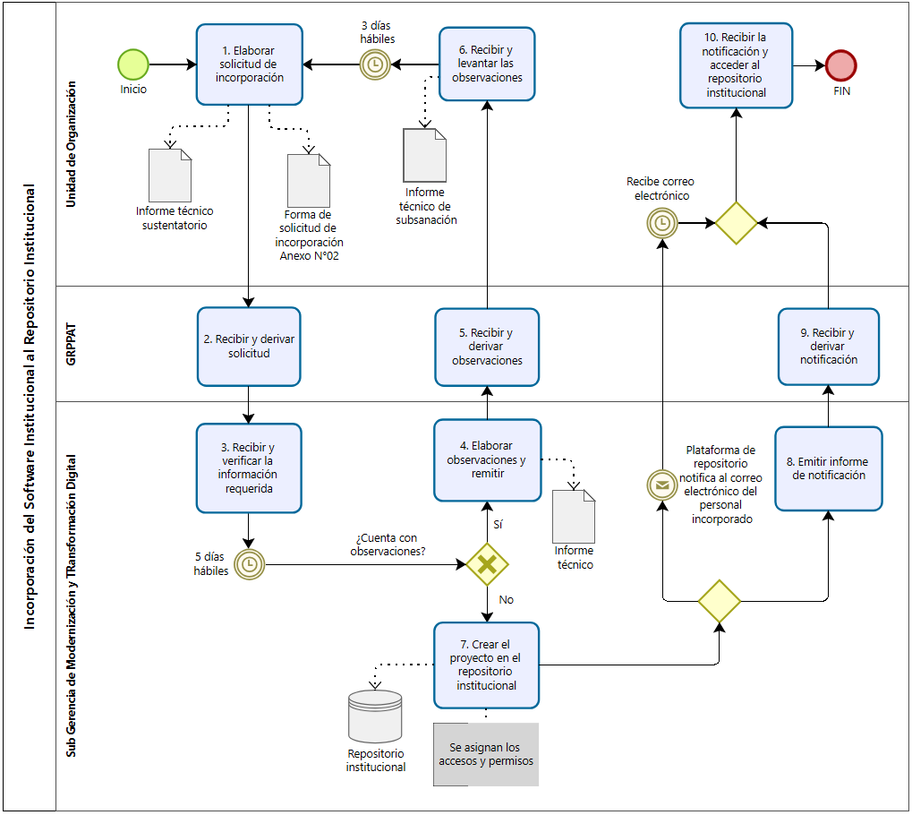
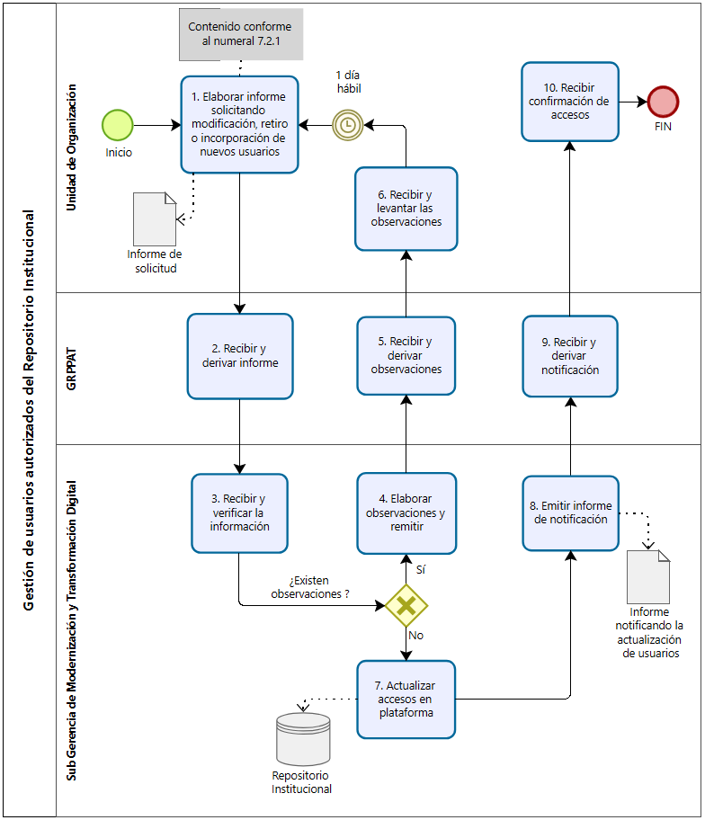
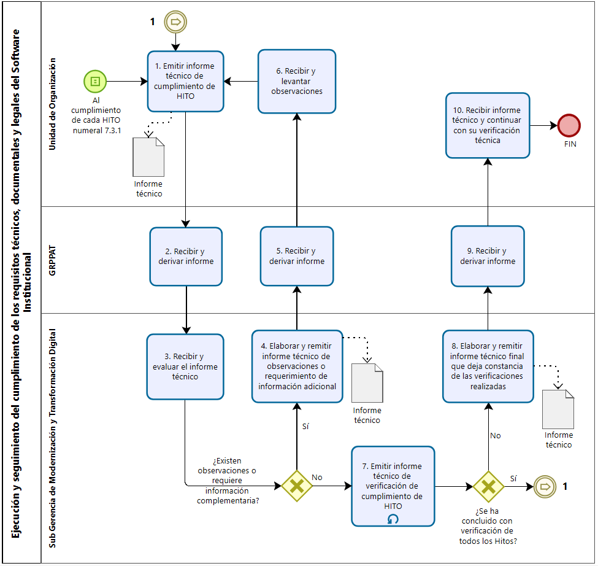
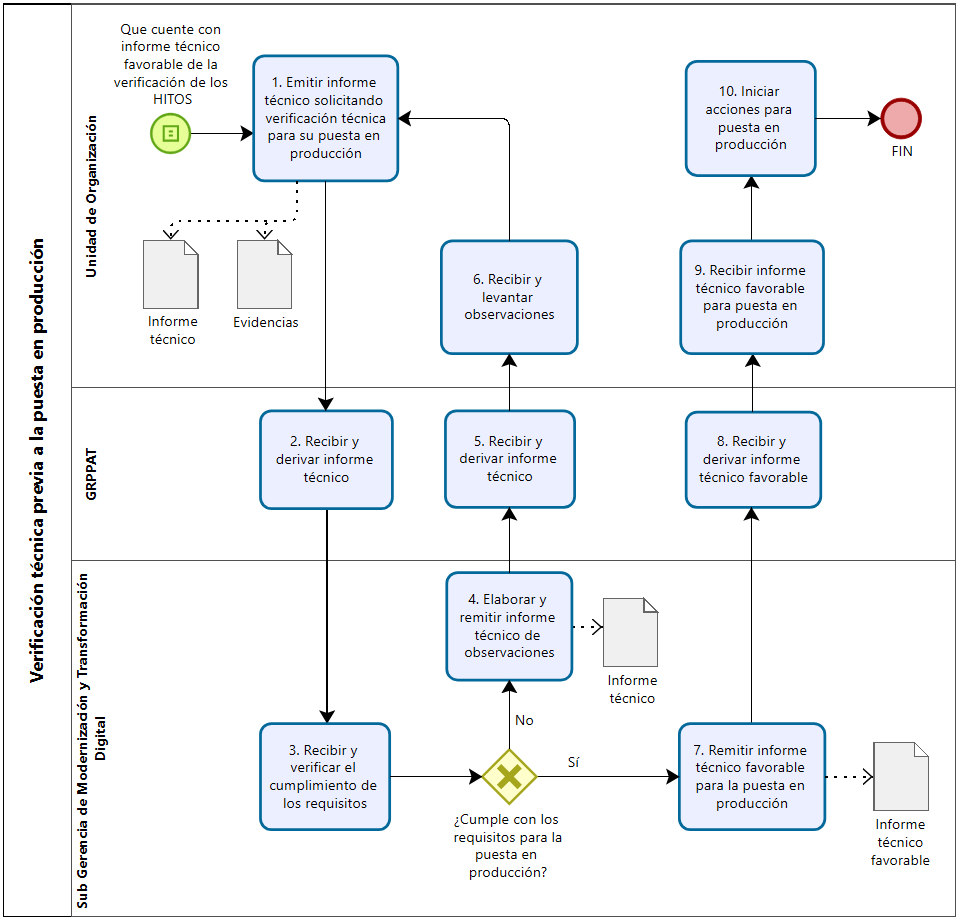
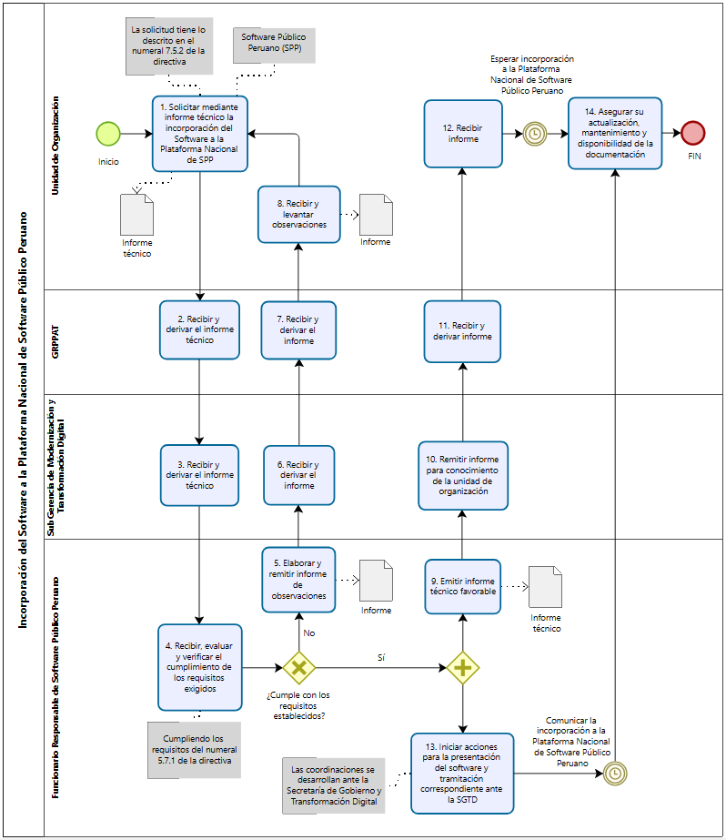

<!--
EXTRACCIÓN LITERAL generada automáticamente con scripts/extraer_docx.py
Origen: originales/directiva-02S5-v1.0.docx (SHA-256 5d729c94f364f33e7a42044ce0640013ff5b634dff94821687cfaeb6b3ea9d31)
Fecha de extracción: 2026-11-10
-->

> **Extracción literal del .docx.** El texto de párrafos y celdas se copió sin resumir ni corregir. La numeración automática de Word se reconstruyó y coincide con el render del .docx (121 de 121 rótulos numéricos) y con el PDF 7501018 salvo "6.3.3.", que solo existe en el .docx.
> **Qué no es literal:** el formato (negritas, sangrías y combinación de celdas se pierden), las tablas se pasan a formato Markdown, las notas al pie se ubican al final como `[^n]`, y los diagramas de los Anexos 10–14 se enlazan como imagen.
> **Estado:** extracción `SIN-REVISAR` por persona. Aprobación y vigencia de la directiva: POR-CONFIRMAR (ver `../../fuente.yaml`). Ante cualquier duda, prevalece el original.
> El Anexo N°05 no forma parte de este .docx (es un PDF aparte); su transcripción está en `resumen-lectura.md`, marcada como no revisada.

| [logo] | Sub Gerencia de Modernización y Transformación Digital |  |
|---|---|---|
| “DIRECTIVA PARA EL DESARROLLO, DOCUMENTACIÓN, VERSIONAMIENTO, LICENCIAMIENTO Y GESTIÓN DE REPOSITORIOS DE SOFTWARE INSTITUCIONAL EN EL GOBIERNO REGIONAL HUÁNUCO” N°02.S5.DI.SGMTD – V1.0. |  |  |
| Etapa | Responsable | Firma y sello |
| Formulado por: | Sub Gerencia de Modernización y Transformación Digital |  |
| Revisado por: | Sub Gerencia de Modernización y Transformación Digital |  |
|  | Gerencia Regional de Asesoría Jurídica |  |
| Aprobado por: | Gerencia General Regional |  |

DIRECTIVA PARA EL DESARROLLO, DOCUMENTACIÓN, VERSIONAMIENTO, LICENCIAMIENTO Y GESTIÓN DE REPOSITORIOS DE SOFTWARE INSTITUCIONAL EN EL GOBIERNO REGIONAL HUÁNUCO

# I. OBJETIVO

Establecer disposiciones para el desarrollo, documentación, versionamiento, licenciamiento y gestión de repositorios de software institucional, con el fin de asegurar la titularidad, trazabilidad, seguridad de la información y gobernanza técnica del software desarrollado en el Gobierno Regional Huánuco.

# II. FINALIDAD

Estandarizar la gestión del software desarrollado en el Gobierno Regional Huánuco, asegurando documentación mínima, control de versiones, uso del repositorio institucional, seguridad de la información, protección de datos personales y criterios técnicos para su licenciamiento, puesta en producción, permanencia como software privado institucional o, de corresponder, liberación como software libre, abierto o Software Público Peruano.

# III. BASE LEGAL

3.1. Ley N°27867, Ley Orgánica de Gobiernos Regionales, y modificatorias.

3.2. Ley N°27444, Ley del Procedimiento Administrativo General, cuyo Texto Único Ordenado fue aprobado mediante Decreto Supremo N°006-2026-JUS, y modificatorias.

3.3. Ley N°27658, Ley Marco de Modernización de la Gestión del Estado, y modificatorias.

3.4. Ley N°27806, Ley de Transparencia y Acceso a la Información Pública, cuyo Texto Único Ordenado fue aprobado mediante Decreto Supremo N°021-2019-JUS y su Reglamento aprobado mediante Decreto Supremo N°007-2024-JUS.

3.5. Ley N°28612, Ley que norma el uso, adquisición y adecuación del software en la administración pública.

3.6. Ley N°32069, Ley General de Contrataciones Públicas, y su Reglamento aprobado mediante Decreto Supremo N°009-2025-EF, y modificatorias.

3.7. Ley N°29733, Ley de Protección de Datos Personales, y modificatorias; y su Reglamento aprobado mediante Decreto Supremo N°016-2024-JUS.

3.8. Decreto Legislativo N°1353, Decreto Legislativo que crea la Autoridad Nacional de Transparencia y Acceso a la Información Pública, fortalece el Régimen de Protección de Datos Personales y regula la gestión de intereses.

3.9. Decreto Legislativo N°822, Ley sobre el Derecho de Autor, y modificatorias.

3.10. Decreto Legislativo N°1412, Decreto Legislativo que aprueba la Ley de Gobierno Digital.

3.11. Decreto Supremo N°024-2006-PCM, que aprueba el Reglamento de la Ley N°28612, Ley que norma el uso, adquisición y adecuación del software en la administración pública.

3.12. Decreto Supremo N°051-2018-PCM, que crea el Portal de Software Público Peruano y establece disposiciones adicionales sobre el Software Público Peruano.

3.13. Decreto Supremo N°029-2021-PCM, que aprueba el Reglamento del Decreto Legislativo N°1412, Ley de Gobierno Digital, y sus modificatorias aprobadas por el Decreto Supremo N°075-2023-PCM y el Decreto Supremo N°098-2026-PCM[^1].

3.14. Decreto Supremo N°085-2023-PCM, Decreto Supremo que aprueba la Política Nacional de Transformación Digital al 2030.

3.15. Decreto de Urgencia N°006-2020, Decreto de Urgencia que crea el Sistema Nacional de Transformación Digital.

3.16. Decreto de Urgencia N°007-2020, Decreto de Urgencia que aprueba el Marco de Confianza Digital y dispone medidas para su fortalecimiento.

3.17. Resolución de Secretaría de Gobierno Digital N°001-2019-PCM/SEGDI, que aprueba la Directiva N°001-2019-PCM/SEGDI, “Directiva para compartir y usar Software Público Peruano”.

3.18. Resolución Ministerial N°004-2016-PCM, que aprueba el uso obligatorio de la Norma Técnica Peruana NTP ISO/IEC 27001:2014, Tecnología de la Información. Técnicas de Seguridad. Sistemas de Gestión de Seguridad de la Información. Requisitos. 2.ª Edición, en todas las entidades integrantes del Sistema Nacional de Informática; y modificatorias o normas técnicas que la sustituyan o actualicen.

3.19. Resolución de Secretaría de Gobierno y Transformación Digital N°003-2023-PCM/SGTD, que establece la implementación y mantenimiento del Sistema de Gestión de Seguridad de la Información en las entidades públicas.

3.20. Resolución de Secretaría de Gobierno Digital N°005-2018-PCM/SEGDI, que aprueba los Lineamientos para la formulación del Plan de Gobierno Digital.

3.21. Ordenanza Regional N°013-2023-GRH-CR, que aprueba el Reglamento de Organización y Funciones del Gobierno Regional Huánuco.

3.22. Resolución Gerencial General N°0167-2025-GRH/GGR, que aprueba el Mapa de Procesos del Gobierno Regional Huánuco, Versión 3.0.

3.23. Resolución Gerencial General N°295-2025-GRH/GGR, que aprueba la Directiva N°01.E2.DI.SGMTD–V2.0, “Directiva General para la formulación, modificación y aprobación de documentos normativos en el Gobierno Regional Huánuco”.

# IV. ALCANCE

La presente directiva es de aplicación obligatoria para todas las Unidades de Organización que conforman el Pliego del Gobierno Regional Huánuco, que desarrollen, contraten, mantengan, modifiquen, documenten, versionen, implementen o administren un software.

# V. RESPONSABILIDADES

5.1. Las Unidades de Organización del Pliego Gobierno Regional Huánuco son responsables de cumplir las disposiciones establecidas en la presente directiva.

5.2. La Sub Gerencia de Modernización y Transformación Digital es responsable de conducir, supervisar y efectuar el seguimiento técnico de la aplicación de la presente Directiva, en el ámbito de sus competencias.

5.3. El Funcionario Responsable del Software Público Peruano es el encargado de coordinar las acciones necesarias para solicitar la incorporación de software institucional a la Plataforma Nacional de Software Público Peruano, conforme a los requisitos establecidos en la normativa aplicable y en la Directiva N.°001-2019-PCM/SEGDI, “Directiva para compartir y usar Software Público Peruano”, aprobada mediante Resolución de Secretaría de Gobierno Digital N.°001-2019-PCM/SEGDI.

# VI. DISPOSICIONES GENERALES

6.1. De las definiciones:

Para efectos de la presente directiva, se consideran las siguientes definiciones:

6.1.1. Código fuente: Conjunto de instrucciones, archivos, scripts, configuraciones y componentes escritos en lenguaje de programación, que permiten comprender, modificar, mantener, compilar, ejecutar o desplegar un software.

6.1.2. Código objeto: Versión compilada, empaquetada o ejecutable de un software, generada a partir del código fuente, destinada a su ejecución en un entorno determinado.

6.1.3. Componente utilitario: Script, librería, módulo o componente de software, comprendido dentro del concepto de software, que no se despliega como sistema o servicio independiente, sino que apoya, automatiza o complementa procesos, sistemas o tareas técnicas ya existentes.

6.1.4. Control de versiones: Conjunto de prácticas y mecanismos que permiten registrar, identificar y administrar los cambios efectuados sobre el código fuente y demás componentes de un software durante su ciclo de vida, asegurando su trazabilidad.

6.1.5. Documentación mínima: Conjunto de documentos técnicos, funcionales y operativos que sustentan el desarrollo, mantenimiento, uso, instalación, configuración, despliegue, operación, pruebas, dependencias y licenciamiento de un software, conforme al anexo correspondiente de la presente directiva.

6.1.6. Licencia de software: Instrumento jurídico que establece las condiciones bajo las cuales puede usarse, modificarse, reproducirse, distribuirse, publicarse, reutilizarse o explotarse un software.

6.1.7. Matriz de dependencias y licencias: Documento técnico que identifica las librerías, paquetes, frameworks, componentes, herramientas o dependencias utilizadas en un software, precisando su versión, origen, finalidad de uso, tipo de licencia, compatibilidad y posibles restricciones.

6.1.8. Modalidad de desarrollo externo: Es el software institucional producido, desarrollado, mantenido, adecuado o documentado total y exclusivamente por locadores de servicios, empresas proveedoras, consultores o terceros contratados por la entidad, bajo términos de referencia, contratos u órdenes de servicio.

6.1.9. Modalidad de desarrollo interno: Es el software institucional producido, mantenido, adecuado o documentado de manera exclusiva por servidores civiles, equipos técnicos o personal informático propio de las Unidades de Organización del Pliego Gobierno Regional Huánuco, en el marco de sus funciones.

6.1.10. Modalidad de desarrollo mixto: Es el software institucional cuyo ciclo de desarrollo, mantenimiento o adecuación se ejecuta de forma conjunta y colaborativa entre el personal propio de la entidad (desarrollo interno) y proveedores o terceros contratados (desarrollo externo).

6.1.11. Puesta en producción: Actividad en la que un software, luego de las verificaciones técnicas correspondientes, es implementado en un entorno operativo real para su uso por parte de usuarios internos, externos o sistemas institucionales.

6.1.12. Repositorio institucional: Plataforma institucional administrada por la Sub Gerencia de Modernización y Transformación Digital para la gestión, control de versiones y trazabilidad del código fuente, scripts, documentación técnica y demás componentes vinculados al ciclo de vida de un software, cuyo acceso se encuentra restringido exclusivamente a usuarios autorizados.

6.1.13. Software abierto: Software cuyo código fuente se encuentra disponible para su acceso, revisión, modificación y distribución bajo los términos de una licencia de código abierto, promoviendo la colaboración y el desarrollo compartido.

6.1.14. Software institucional: Programa de ordenador, sistema informático, aplicativo, módulo, componente, servicio digital, script, base de datos, interfaz o elemento relacionado, producido bajo cualquier modalidad de desarrollo (interno, externo o mixto), así como su mantenimiento, adecuación o documentación, destinado al uso institucional del Gobierno Regional Huánuco.

6.1.15. Software libre: Software que garantiza a los usuarios la libertad de ejecutar, estudiar, modificar, mejorar, copiar y redistribuir el programa, conforme a los términos establecidos en una licencia libre.

6.1.16. Software privado institucional: Software institucional, cuyo uso, modificación, distribución o publicación se mantiene restringido al Gobierno Regional Huánuco, por razones técnicas, legales, contractuales, operativas, de seguridad de la información, protección de datos personales o conveniencia institucional.

6.1.17. Software Público Peruano: Software que cumple las condiciones, requisitos técnicos, jurídicos y de licenciamiento establecidos en la normativa nacional vigente sobre Software Público Peruano y que puede ser compartido a través de la Plataforma Nacional de Software Público Peruano.

6.1.18. Derechos sobre el software: Condición jurídica que permite a la entidad, según corresponda, ejercer derechos patrimoniales, derechos de uso o facultades de explotación sobre el software, código fuente, documentación, componentes y demás elementos vinculados, de acuerdo con el título jurídico que los sustente. Para efectos de esta directiva comprende:

- Titularidad institucional: Cuando el Gobierno Regional Huánuco es titular de los derechos patrimoniales correspondientes (Ej. Desarrollos internos o contratos con cesión total de derechos).

- Licencia de software: Cuando la entidad es únicamente licenciataria o usuaria autorizada (Ej. Uso de software privativo de terceros o librerías externas).

6.2. Del desarrollo e incorporación al repositorio institucional

6.2.1. Todo software institucional desarrollado por o para el Gobierno Regional Huánuco debe incorporarse al repositorio institucional, cuando corresponda y en la medida en que la entidad cuente con los derechos necesarios para ello, conforme a la normativa aplicable y a las condiciones contractuales o de licenciamiento.

6.2.2. El repositorio institucional constituye el medio institucional para almacenar y gestionar el código fuente, documentación técnica, scripts, archivos de configuración, registros de versiones y demás componentes relacionados con el software institucional.

6.2.3. La Sub Gerencia de Modernización y Transformación Digital es la encargada de la generación de copias de respaldo periódicas del repositorio institucional.

6.3. De la titularidad institucional y derechos patrimoniales

6.3.1. Todo software institucional cuenta con evidencia que permite acreditar la titularidad institucional o los derechos patrimoniales de uso, reproducción, modificación, distribución y demás facultades que corresponden sobre el software, código fuente, documentación técnica, manuales, bases de datos, scripts y componentes desarrollados para la entidad.

6.3.2. Cuando el desarrollo, mantenimiento, adecuación, soporte o documentación del software es realizado por terceros, se incorporan disposiciones para asegurar la cesión o acreditación de los derechos patrimoniales correspondientes a favor del Gobierno Regional Huánuco.

La cláusula de cesión de derechos patrimoniales y entrega del código fuente se encuentra contenida en el Anexo N°01.

6.3.3. Determinación de facultades según el origen del software. Para evitar contingencias legales, la gestión, modificación y distribución del software institucional se sujeta al siguiente cuadro de diferenciación de derechos:

Tabla 1. Diferenciación de derechos sobre el software institucional

| Origen del componente / software | Figura jurídica aplicable | Facultades permitidas al Gobierno Regional Huánuco |
|---|---|---|
| Desarrollo interno o externo a medida | Titularidad Institucional (Por autoría propia o por cesión de derechos patrimoniales) | Control total. Permite modificar el código, sublicenciarlo, publicarlo o postularlo como Software Público Peruano |
| Software o componente privativo de terceros (Ej. APIs comerciales) | Licencia de uso (Autorización o derecho de explotación bajo condiciones) | Uso restringido. Solo permite el uso según el contrato. NO permite modificar el código base, ni sublicenciar, ni publicar libremente. |
| Librería o componente Open Source (Ej. Frameworks) | Licencia libre / abierta (Derechos conforme a la licencia de origen) | Uso condicionado. Permite uso y modificación, pero sujeto estrictamente a las reglas de su licencia (MIT, GPL, etc.). |

6.4. Del versionamiento del software institucional

6.4.1. Todo software institucional se mantiene bajo un mecanismo de control de versiones que conserva la trazabilidad de modificaciones, identifica los cambios realizados, funcionalidades incorporadas, mejoras realizadas, correcciones efectuadas y registra el estado de madurez del software durante su ciclo de vida.

6.5. De la seguridad de la información y protección de datos personales

6.5.1. Todo software institucional incorpora, desde su diseño y desarrollo, medidas y controles que aseguran la protección de datos personales, cuando corresponda, así como garantizan la seguridad de la información mediante el uso de protocolos seguros de almacenamiento y comunicación, algoritmos estándar de codificación y demás mecanismos pertinentes, de acuerdo con la Ley N.°29733, Ley de Protección de Datos Personales, el Decreto de Urgencia N.°007-2020 que aprueba el Marco de Confianza Digital, la Resolución Ministerial N.°004-2016-PCM y la Resolución de Secretaría de Gobierno y Transformación Digital N°003-2023-PCM/SGTD que disponen el uso obligatorio de la NTP ISO/IEC 27001 vigente, sus normas complementarias, y las demás disposiciones vigentes sobre seguridad digital y gestión de la información.

6.6. De la seguridad en el repositorio institucional

6.6.1. Se prohíbe la incorporación de credenciales, contraseñas, tokens, claves privadas, certificados digitales, datos personales reales, información confidencial, configuraciones sensibles o cualquier otro elemento que pueda comprometer la seguridad de la información de la entidad, al repositorio institucional.

6.6.2. Las configuraciones sensibles se gestionan mediante variables de entorno, archivos de ejemplo, gestores de secretos u otros mecanismos técnicos equivalentes.

6.6.3. Cuando el software requiere datos de prueba, se utilizan datos ficticios, anonimizados o seudonimizados.

6.7. Del licenciamiento del software institucional

6.7.1. La determinación del licenciamiento aplicable al software institucional se sustenta en una evaluación técnica, funcional, legal y de compatibilidad entre las licencias del software y de sus dependencias.

6.8. Del Software Público Peruano

6.8.1. El software institucional propuesto para su incorporación a la Plataforma Nacional de Software Público Peruano cumple con las disposiciones establecidas en el Decreto Supremo N°051-2018-PCM y en la Directiva N.°001-2019-PCM/SEGDI, “Directiva para compartir y usar Software Público Peruano”, aprobada mediante Resolución de Secretaría de Gobierno Digital N.°001-2019-PCM/SEGDI.

6.9. De los formatos de la documentación técnica

6.9.1. La documentación técnica exigida por la presente directiva se elabora y mantiene en formatos ligeros y versionados dentro del repositorio institucional (por ejemplo, archivos en formato Markdown), sin eximir del cumplimiento del contenido mínimo exigible conforme a los anexos correspondientes.

6.9.2. La documentación técnica se elabora de manera incremental, conforme al estado de avance del software institucional, y se mantiene actualizada y consistente con el estado real del software al momento de cada verificación establecida en la presente directiva.

# VII. DISPOSICIONES ESPECÍFICAS

7.1. Incorporación del software institucional al repositorio institucional

7.1.1. Previo al inicio del desarrollo de un software institucional, las Unidades de Organización solicitan a la Sub Gerencia de Modernización y Transformación Digital, por intermedio de la Gerencia Regional de Planeamiento, Presupuesto y Acondicionamiento Territorial, su incorporación al repositorio institucional del Gobierno Regional Huánuco. Dicha solicitud se realiza mediante un informe técnico sustentatorio acompañado del formato establecido en el Anexo N°02, debidamente suscrito por el jefe de la Unidad de Organización.

La solicitud de incorporación no requiere contar con la documentación técnica completa, determinación de licencia, documentación de puesta en producción u otros requisitos que se desarrollan progresivamente durante el ciclo de vida del software.

7.1.2. Una vez recibido el informe técnico, la Sub Gerencia de Modernización y Transformación Digital cuenta con un plazo máximo de cinco (5) días hábiles para verificar la información mínima requerida y, de corresponder, formular observaciones mediante informe técnico.

7.1.3. De existir observaciones, la Sub Gerencia de Modernización y Transformación Digital devuelve el documento de acuerdo con las líneas de comunicación correspondientes al orden jerárquico. La Unidad de Organización cuenta con un plazo máximo de tres (3) días hábiles para efectuar el levantamiento de las observaciones y remitir la subsanación mediante un informe técnico.

7.1.4. De verificarse el cumplimiento de la información requerida o una vez subsanadas las observaciones, la Sub Gerencia de Modernización y Transformación Digital crea el proyecto en la plataforma del repositorio institucional. La plataforma notifica automáticamente al personal incorporado al repositorio mediante correo electrónico. Asimismo, la Sub Gerencia de Modernización y Transformación Digital emite el informe respectivo indicando la creación del proyecto y la asignación de accesos a los responsables técnicos autorizados consignados en la solicitud, derivándolo a la Unidad de Organización correspondiente.

7.2. Gestión de usuarios autorizados del repositorio institucional

7.2.1. Las Unidades de Organización responsables del software que requieran la modificación, retiro o incorporación de nuevos usuarios autorizados para el acceso al repositorio institucional, remiten un informe dirigido a la Sub Gerencia de Modernización y Transformación Digital, por intermedio de la Gerencia Regional de Planeamiento, Presupuesto y Acondicionamiento Territorial, detallando lo siguiente:

- Nombre del software o repositorio correspondiente;

- Tipo de solicitud (Incorporación, retiro o modificación de roles);

- Nombres completos del usuario;

- Modalidad de contratación;

- Cargo o función;

- Nombre de usuario en la plataforma;

- Correo electrónico asociado a la cuenta;

- Rol solicitado.

7.2.2. De existir observaciones, la Sub Gerencia de Modernización y Transformación Digital devuelve el documento de acuerdo con las líneas de comunicación correspondientes al orden jerárquico. La Unidad de Organización cuenta con un plazo máximo de un (1) día hábil para el levantamiento de las observaciones que correspondan.

7.2.3. De verificarse el cumplimiento de la información requerida o una vez subsanadas las observaciones, la Sub Gerencia de Modernización y Transformación Digital realiza la actualización correspondiente de los usuarios en la plataforma del repositorio institucional. Asimismo, emite un informe notificando dicha actualización y lo comunica a la Unidad de Organización correspondiente.

7.2.4. Cuando la Sub Gerencia de Modernización y Transformación Digital identifique riesgos para la seguridad de la información o incumplimiento de la presente directiva, suspende o retira los accesos otorgados y notifica a la Unidad de Organización correspondiente.

7.3. Ejecución y seguimiento del cumplimiento de los requisitos técnicos, documentales y legales del software institucional

7.3.1. Las Unidades de Organización a cargo del desarrollo de software cumplen con los hitos establecidos de acuerdo con la naturaleza del software:

a) Para el software institucional que constituye una solución independiente y completa, cumplen, de manera progresiva, con los siguientes hitos:

i. Hito de análisis y diseño

Conlleva como mínimo el contenido siguiente:

- Documentación de requerimientos, preliminar.

- Documento de análisis, preliminar.

- Documento de diseño, preliminar.

- Documento de arquitectura y componentes, preliminar.

- Verificación preliminar de la titularidad institucional o de las condiciones contractuales relacionadas con los derechos patrimoniales.

- Control de versiones.

- Medidas previstas para la seguridad de la información y protección de datos personales.

- Matriz inicial de dependencias, librerías y componentes utilizados, conforme al Anexo N°03.

ii. Hito de desarrollo y pruebas

Conlleva como mínimo el contenido siguiente:

- Avance y actualización de la documentación técnica de desarrollo (incluyendo requerimientos, análisis, diseño, arquitectura y demás documentos que correspondan al estado de avance del software).

- Documento de plan de pruebas funcionales y no funcionales.

- Documento de manual de operaciones.

- Control de versiones y trazabilidad de cambios.

- Actualización de la matriz de dependencias, librerías y componentes utilizados, conforme al Anexo N°03.

- Implementación de medidas de seguridad de la información y protección de datos personales.

iii. Hito previo a la puesta en producción

Conlleva como mínimo el contenido siguiente:

- Manual de usuario.

- Manual de instalación y configuración.

- Diccionario de datos.

- Determinación del licenciamiento aplicable.

- Incorporación de glosas de licencia, cuando corresponda.

- Incorporación del archivo "LICENCIA.txt", cuando corresponda.

- Referencias de licencia en el código fuente, cuando corresponda.

- Verificación de la versión candidata a producción y su registro de cambios correspondiente.

- Verificación definitiva de la titularidad institucional o acreditación de derechos patrimoniales.

- Verificación integral de los requisitos técnicos, documentales y legales establecidos en la presente directiva y conforme al Anexo N°04.

b) Para los componentes utilitarios, conforme al numeral 6.1.3, cumplen con un único hito de verificación, que comprende como mínimo lo siguiente:

- Ficha Técnica del Componente, conforme al Anexo N°04-A.

- Control de versiones y trazabilidad de cambios.

- Matriz de dependencias, librerías y componentes utilizados, conforme al Anexo N°03.

- Determinación del licenciamiento aplicable.

- Verificación de la titularidad institucional o acreditación de derechos patrimoniales.

- Medidas de seguridad de la información y protección de datos personales, cuando corresponda.

7.3.2. Las Unidades de Organización, para el control de las versiones, emplean la estructura “Mayor.Menor.Corrección (X.Y.Z)”, lo que permite mantener la trazabilidad de los cambios realizados.

- La versión mayor (X) identifica cambios significativos, nuevas funcionalidades o liberaciones relevantes del software.

- La versión menor (Y) identifica mejoras funcionales, ampliaciones o modificaciones compatibles con la versión principal.

- La versión de corrección (Z) identifica ajustes, correcciones de errores o cambios menores que no modifican la funcionalidad principal.

a) Se considera versión mayor (X) todo cambio que: (i) afecta la compatibilidad de funcionalidades, integraciones o procesos existentes; (ii) modifica la arquitectura, el motor de base de datos o las medidas estructurales de seguridad de la información o protección de datos personales; o (iii) incorpora un módulo, flujo de trabajo o funcionalidad que no forma parte del alcance previamente aprobado del software, independientemente de su extensión. Se considera versión menor (Y) toda extensión, mejora o ampliación de una funcionalidad ya existente que no genera los efectos señalados en los literales precedentes.

b) La primera versión estable del software, destinada a solicitar la verificación técnica previa a la puesta en producción, se identifica como versión “1.0.0”.

7.3.3. Las Unidades de Organización, para la determinación de la licencia aplicable, toman en cuenta que;

a) La determinación de la licencia aplicable al software se sustenta mediante un informe técnico elaborado considerando la matriz comparativa de licencias libres y abiertas establecida en el Anexo N°05[^2]. Dicha matriz puede ser actualizada mediante documento técnico complementario por la Sub Gerencia de Modernización y Transformación Digital, cuando existan nuevas licencias, modificaciones relevantes, nuevos criterios técnicos o necesidades institucionales debidamente sustentadas.

b) Cuando la evaluación determine que ninguna licencia libre o abierta resulta compatible con las características técnicas, funcionales o legales del software institucional, se adopta un esquema de software privativo institucional, debidamente sustentado.

c) El informe técnico de determinación de licencia forma parte del expediente técnico del software institucional.

7.3.4. Determinada la aplicación de una licencia libre o abierta al software institucional, las Unidades de Organización aseguran el cumplimiento de lo siguiente:

a) La documentación asociada incorpora las glosas de licencia establecidas en el Anexo N°06.

b) En el repositorio institucional se incorpora el archivo "LICENCIA.txt" conforme al Anexo N°07.

c) Todos los archivos fuente incorporan comentarios, notas, encabezados u otros mecanismos equivalentes que identifican la licencia aplicable o remiten expresamente al archivo "LICENCIA.txt".

Tabla 2. Ejemplos de nota o comentario de licencia

| /* (…) @licencia [nombre de la licencia libre o abierta] ver LICENCIA.txt (…) */ |
|---|
| /* (…) @licencia ver LICENCIA.txt (…) */ |
| ''' (…) @licencia ver LICENCIA.txt (…) ''' |

7.3.5. Al cumplimiento de cada hito, las Unidades de Organización responsables del software remiten un informe técnico dirigido a la Sub Gerencia de Modernización y Transformación Digital, por intermedio de la Gerencia Regional de Planeamiento, Presupuesto y Acondicionamiento Territorial, para su revisión.

7.3.6. Una vez recibido el informe técnico, la Sub Gerencia de Modernización y Transformación Digital verifica la información mínima requerida y, de corresponder, formula observaciones mediante un informe técnico, y remite el documento de acuerdo con las líneas de comunicación correspondientes al orden jerárquico. La Unidad de Organización efectúa el levantamiento de las observaciones y remite la subsanación mediante un informe técnico.

7.3.7. De verificarse el cumplimiento del hito, la información requerida o una vez subsanadas las observaciones, la Sub Gerencia de Modernización y Transformación Digital emite un informe técnico que deja constancia de las verificaciones realizadas, las observaciones formuladas y las subsanaciones efectuadas.

7.3.8. Concluido el seguimiento y verificado el cumplimiento de todos los hitos, la Sub Gerencia de Modernización y Transformación Digital emite un informe técnico final, consignando el resultado de la evaluación y  lo remite a la unidad de organización responsable a través de la Gerencia Regional de Planeamiento, Presupuesto y Acondicionamiento Territorial.

El informe técnico favorable, emitido en el marco de este seguimiento, constituye un requisito obligatorio y previo para solicitar la verificación técnica de puesta en producción.

7.3.9. La Sub Gerencia de Modernización y Transformación Digital efectúa el seguimiento del cumplimiento de cada hito, que comprende la verificación progresiva de los requisitos técnicos, documentales y legales. Para tal efecto, puede solicitar a las Unidades de Organización responsables del desarrollo del software la información y documentación complementaria que resulte necesaria, formular observaciones y requerir las subsanaciones respectivas.

7.4. Verificación técnica previa a la puesta en producción

7.4.1. Todo software institucional que constituya una solución independiente y completa, y que cuente con informe técnico favorable, se encuentra habilitado para solicitar su verificación técnica previa a la puesta en producción. Dicha solicitud es remitida por la Unidad de Organización responsable del software mediante un informe técnico dirigido a la Sub Gerencia de Modernización y Transformación Digital, por intermedio de la Gerencia Regional de Planeamiento, Presupuesto y Acondicionamiento Territorial.

7.4.2. El informe técnico de solicitud adjunta como mínimo:

- Informe técnico favorable emitido en el marco del procedimiento de seguimiento;

- Evidencias de funcionamiento del software, tales como capturas de pantalla, videos, registros de pruebas, accesos de demostración u otros medios equivalentes;

- Informe técnico de determinación de licencia;

- Evidencias de titularidad institucional o acreditación de derechos patrimoniales;

- Evidencias de implementación de medidas de seguridad de la información y protección de datos personales, cuando corresponda.

- Demás documentación que sustente el cumplimiento de los requisitos aplicables.

7.4.3. De identificarse observaciones o incumplimientos, la Sub Gerencia de Modernización y Transformación Digital emite el informe técnico correspondiente detallando las observaciones y las acciones requeridas para su subsanación, y devuelve el documento de acuerdo con las líneas de comunicación correspondientes al orden jerárquico. La Unidad de Organización efectúa el levantamiento de las observaciones y remite la subsanación mediante un informe técnico.

7.4.4. De verificarse el cumplimiento de los requisitos aplicables o una vez subsanadas las observaciones, la Sub Gerencia de Modernización y Transformación Digital emite el informe técnico favorable para la puesta en producción, el cual es comunicado a la Unidad de Organización responsable del software.

7.4.5. En el caso del software institucional que ya se encuentre operando en producción, toda nueva versión que implique un cambio de versión mayor (X), conforme al numeral 7.3.2, así como cualquier cambio de arquitectura o modificación que afecte la seguridad de la información o la protección de datos personales, se somete nuevamente al procedimiento de verificación técnica.

Las nuevas versiones que solo implican cambio de versión menor (Y) o de corrección (Z) no requieren una nueva verificación técnica completa; sin embargo, cuando se actualice la documentación técnica, la Unidad de Organización debe informar sobre ello a la Sub Gerencia de Modernización y Transformación Digital, mediante un informe para conocimiento.

Excepcionalmente, cuando la Unidad de Organización responsable del software identifique una vulnerabilidad o riesgo de seguridad de la información que amerite una corrección inmediata, puede aplicar dicha corrección sobre el software en producción sin contar previamente con la conformidad técnica de la Sub Gerencia de Modernización y Transformación Digital. En dicho caso, la Unidad de Organización:

a) Comunica a la Sub Gerencia de Modernización y Transformación Digital la aplicación de la corrección, dentro de las veinticuatro (24) horas siguientes a su despliegue, señalando el riesgo identificado y la solución aplicada.

b) Registra la corrección en el control de versiones del repositorio institucional, conforme al numeral 7.3.2.

c) Actualiza y remite, en un plazo no mayor a cinco (5) días hábiles, la documentación técnica correspondiente, para la regularización de la conformidad respectiva.

Esta vía excepcional se aplica únicamente a correcciones de seguridad urgentes y no exime a la Unidad de Organización responsable del cumplimiento de las demás disposiciones establecidas en la presente directiva.

7.4.6. Ningún software institucional es puesto en producción sin contar previamente con el informe técnico favorable emitido por la Sub Gerencia de Modernización y Transformación Digital, salvo el supuesto excepcional previsto en el numeral 7.4.5.

7.5. Incorporación del software a la Plataforma Nacional de Software Público Peruano

7.5.1. Las Unidades de Organización responsables del software pueden solicitar la incorporación del software institucional a la Plataforma Nacional de Software Público Peruano, mediante un informe técnico dirigido a la Sub Gerencia de Modernización y Transformación Digital, por intermedio de la Gerencia Regional de Planeamiento, Presupuesto y Acondicionamiento Territorial, para atención del Funcionario Responsable de Software Público Peruano, siempre que el software cumpla con lo siguiente:

a) Cuente con informe técnico favorable para su puesta en producción emitido conforme a la presente directiva.

b) Se encuentre en producción mediante una versión estable.

c) Haya permanecido en producción de manera comprobada por un período mínimo de un (01) año.

d) Cuente con una licencia libre o abierta compatible con su publicación como Software Público Peruano.

e) Cumpla los requisitos establecidos en el Decreto Supremo N°051-2018-PCM y la Directiva N°001-2019-PCM/SEGDI.

7.5.2. El informe técnico contiene como mínimo:

- Informe técnico que sustente la propuesta de incorporación a la Plataforma Nacional de Software Público Peruano.

- Formato de especificación general del software conforme al Anexo N°08.

- Archivo "LICENCIA.txt" adecuado para su publicación conforme al Anexo N°09.

- Evidencia de encontrarse en producción mediante una versión estable por un período mínimo de un (01) año.

- Documentación adicional exigida por la normativa aplicable para la incorporación al Software Público Peruano.

7.5.3. El informe técnico es recibido por parte del Funcionario Responsable de Software Público Peruano, quien realiza la evaluación y verificación del cumplimiento de los requisitos exigidos.

7.5.4. De existir observaciones o incumplimientos, el Funcionario Responsable de Software Público Peruano, en coordinación con la Gerencia Regional de Asesoría Jurídica, emite un informe correspondiente detallando las observaciones y las acciones requeridas para su subsanación, y lo devuelve a la Unidad de Organización responsable de acuerdo con las líneas de comunicación correspondientes al orden jerárquico. La Unidad de Organización efectúa el levantamiento de las observaciones y remite la subsanación mediante un informe técnico.

7.5.5. De verificarse el cumplimiento de los requisitos aplicables, el Funcionario Responsable de Software Público Peruano emite el informe técnico favorable y efectúa las acciones necesarias para la presentación del software y tramitación correspondiente ante la Secretaría de Gobierno y Transformación Digital.

7.5.6. La evaluación, observación, subsanación, aprobación, publicación, actualización, retiro o demás actuaciones posteriores ante la Plataforma Nacional de Software Público Peruano se sujetan a las disposiciones emitidas por la Secretaría de Gobierno y Transformación Digital y a la normativa vigente sobre la materia.

7.5.7. Las Unidades de Organización responsables del software incorporado a la Plataforma Nacional de Software Público Peruano mantienen la responsabilidad obligatoria de asegurar su actualización, mantenimiento, disponibilidad de la documentación, atención de observaciones y cumplimiento de las disposiciones establecidas en la normativa aplicable.

# VIII. PROCESO RELACIONADO

La presente directiva se encuentra relacionado al proceso de apoyo de nivel 1 denominado S5.2 Desarrollo e Implementación de Servicios Digitales del proceso S5. Gestión de Transformación Digital considerada en el Mapa de Procesos del Gobierno Regional Huánuco Versión 3.0, aprobado con Resolución Gerencial General N°0167-2025-GRH/GGR, según se muestra en el siguiente cuadro.

Tabla 3. Proceso Relacionado

| Proceso Nivel 0 | Proceso Nivel 1 |  |  |
|---|---|---|---|
| S5 | Gestión de Transformación Digital | S5.2 | Desarrollo e Implementación de Servicios Digitales |

# IX. DISPOSICIONES COMPLEMENTARIAS

9.1. La Sub Gerencia de Modernización y Transformación Digital puede actualizar, modificar o sustituir la plataforma de alojamiento de código, organización, estructura de repositorios, nomenclatura, reglas de acceso, políticas de ramas, plantillas, formatos o mecanismos técnicos de control de versiones, cuando resulte necesario para garantizar la seguridad, trazabilidad, continuidad operativa y gobernanza técnica del software institucional.

Cuando dichas modificaciones impliquen cambios en obligaciones, responsabilidades, requisitos, procedimientos, derechos o plazos y condiciones establecidas explícitamente en la presente Directiva, no podrán realizarse de manera unilateral, debiendo tramitarse conforme al procedimiento previsto para la modificación de documentos normativos institucionales.

9.2. De los procedimientos aplicables a las Unidades Ejecutoras

9.2.1. Las Unidades Ejecutoras del Pliego Gobierno Regional Huánuco, cumplen lo dispuesto en la presente directiva y efectúan la evaluación preliminar de los procedimientos establecidos a través de la dependencia que ejerce funciones equivalentes a la Sub Gerencia de Modernización y Transformación Digital o la que haga sus veces.

9.2.2. Durante la evaluación preliminar, dicha dependencia verifica el cumplimiento de los requisitos técnicos, documentales y legales aplicables; puede formular observaciones, requerir información complementaria, devolver el expediente para su subsanación y efectuar las revisiones que resulten necesarias hasta verificar el cumplimiento de los requisitos establecidos.

En caso de requerir asistencia técnica, lo solicitan a la Sub Gerencia de Modernización y Transformación Digital, la cual brinda la orientación y el soporte técnico correspondiente en el marco de sus competencias.

9.2.3. Una vez culminada la evaluación preliminar y verificadas las subsanaciones correspondientes, la dependencia emite el informe técnico respectivo, en el que se consignen las verificaciones efectuadas, observaciones formuladas, información complementaria solicitada, subsanaciones realizadas y el resultado de la evaluación preliminar.

9.2.4. La Unidad Ejecutora remite a la Sub Gerencia de Modernización y Transformación Digital, por intermedio de la Gerencia Regional de Planeamiento, Presupuesto y Acondicionamiento Territorial, el expediente completo, acompañado del informe técnico emitido durante la evaluación preliminar y la documentación sustentatoria correspondiente, para la evaluación y pronunciamiento final.

9.3. La incorporación del proyecto al repositorio institucional no exime del cumplimiento de las disposiciones relacionadas con documentación mínima, control de versiones, titularidad institucional, licenciamiento, seguridad de la información, protección de datos personales y demás obligaciones establecidas en la presente directiva.

9.4. Los aspectos técnicos no previstos expresamente serán atendidos por la Sub Gerencia de Modernización y Transformación Digital dentro del marco de sus competencias y de la normativa vigente, sin que dicha actuación implique crear nuevas obligaciones, modificar procedimientos o establecer restricciones no previstas en la presente Directiva.

# X. DISPOSICIONES FINALES

10.1. La presente directiva entra en vigencia a partir del día siguiente de su aprobación mediante el acto resolutivo correspondiente.

10.2. Las Unidades de Organización que conforman el Pliego Gobierno Regional Huánuco adoptan obligatoriamente las acciones necesarias para el cumplimiento de la presente directiva, en el marco de sus competencias y responsabilidades.

10.3. La Sub Gerencia de Modernización y Transformación Digital queda encargada de brindar orientación técnica para la implementación de la presente directiva.

10.4. Toda disposición interna, lineamiento, práctica, criterio operativo o actuación administrativa incompatible con lo establecido en la presente directiva se adecúa a sus disposiciones, sin perjuicio de la normativa vigente aplicable.

10.5. La aplicación de la presente directiva no exime a las Unidades de Organización del Pliego Gobierno Regional Huánuco del cumplimiento de las normas sobre derecho de autor, contratación pública, seguridad de la información, protección de datos personales, transparencia, gobierno digital y demás normativa aplicable.

# XI. DISPOSICIONES TRANSITORIAS

11.1. Las Unidades de Organización que, a la entrada en vigencia de la presente directiva, cuentan con software institucional desarrollado internamente que se encuentra en producción o cuyo desarrollo ha concluido, regularizan su adecuación a las disposiciones establecidas en la presente directiva, incluyendo su incorporación al repositorio institucional, documentación técnica, control de versiones, titularidad institucional, licenciamiento y demás requisitos aplicables.

Para dicho efecto, remiten a la Sub Gerencia de Modernización y Transformación Digital, por intermedio de la Gerencia Regional de Planeamiento, Presupuesto y Acondicionamiento Territorial, en un plazo máximo de sesenta (60) días hábiles contados desde la entrada en vigencia de la presente directiva, el inventario del software institucional desarrollado internamente que se encuentra en producción o cuyo desarrollo ha concluido, acompañado de la siguiente información y documentación, según corresponda:

a) Tratándose de software institucional que constituye una solución independiente y completa:

- Documentación mínima establecida en el Anexo N°04, en su integridad.

- Control de versiones y trazabilidad de cambios.

- Matriz de dependencias, librerías y componentes utilizados, conforme al Anexo N°03.

- Determinación del licenciamiento aplicable, mediante el informe técnico correspondiente.

- Incorporación de glosas de licencia, cuando corresponda.

- Incorporación del archivo "LICENCIA.txt", cuando corresponda.

- Referencias de licencia en el código fuente, cuando corresponda.

- Verificación definitiva de la titularidad institucional o acreditación de derechos patrimoniales.

- Implementación de medidas de seguridad de la información y protección de datos personales.

- Incorporación al repositorio institucional, conforme al numeral 7.1.

b) Tratándose de componentes utilitarios, conforme al numeral 6.1.3:

- Ficha Técnica del Componente, conforme al Anexo N°04-A, en su integridad.

- Control de versiones y trazabilidad de cambios.

- Matriz de dependencias, librerías y componentes utilizados, conforme al Anexo N°03.

- Determinación del licenciamiento aplicable.

- Verificación de la titularidad institucional o acreditación de derechos patrimoniales.

- Medidas de seguridad de la información y protección de datos personales, cuando corresponda.

- Incorporación al repositorio institucional, conforme al numeral 7.1.

En el caso de las Unidades Ejecutoras, el inventario, la información y la documentación correspondiente son evaluados preliminarmente por la dependencia que ejerce funciones equivalentes a la Sub Gerencia de Modernización y Transformación Digital o la que haga sus veces, la cual efectúa la revisión, formula las observaciones que correspondan, verifica su subsanación y deja constancia de dicha evaluación mediante el informe respectivo, antes de su remisión, a través de la Unidad Ejecutora, a la Sub Gerencia de Modernización y Transformación Digital, por intermedio de la Gerencia Regional de Planeamiento, Presupuesto y Acondicionamiento Territorial, para la evaluación y pronunciamiento final.

11.2. El software institucional desarrollado internamente que, a la entrada en vigencia de la presente directiva, se encuentra en desarrollo y aún no ha concluido, no se sujeta al procedimiento de regularización establecido en las presentes disposiciones transitorias. Dicho software se incorpora al repositorio institucional conforme al numeral 7.1 y continúa su ciclo de vida bajo el seguimiento progresivo por hitos establecido en el numeral 7.3, según la naturaleza de su desarrollo.

11.3. A solicitud expresa de la Unidad de Organización responsable, se incorporan al proceso de regularización los software institucionales desarrollados internamente que se encuentran retirados, fuera de servicio o cuya operación haya concluido, cuando resulte necesario para preservar su documentación, código fuente, titularidad institucional o antecedentes técnicos.

11.4. La Sub Gerencia de Modernización y Transformación Digital evalúa el inventario, la información y la documentación remitida, pudiendo requerir información complementaria, formular observaciones, solicitar las subsanaciones correspondientes y disponer las acciones de regularización necesarias para el cumplimiento de la presente directiva.

11.5. La regularización prevista en las presentes disposiciones transitorias no suspende la operación del software institucional que se encuentra en producción; sin perjuicio de ello, cualquier actividad de mantenimiento, adecuación, evolución, incorporación de nuevas funcionalidades, liberación de nuevas versiones o modificación posterior se sujeta íntegramente a las disposiciones establecidas en la presente directiva.

# XII. ANEXOS

- Anexo N°01: Cláusula modelo sobre cesión de derechos patrimoniales y entrega de código fuente.

- Anexo N°02: Formato de solicitud de incorporación al repositorio institucional.

- Anexo N°03: Formato de matriz de dependencias y licencias.

- Anexo N°04: Cuadro de documentación mínima exigible para software institucional.

- Anexo N°04-A: Ficha técnica del componente utilitario.

- Anexo N°05: Matriz comparativa de licencias libres y abiertas.

- Anexo N°06: Glosa de licencia para documentación de software libre, abierto o Software Público Peruano.

- Anexo N°07: Modelo para el archivo LICENCIA.txt en Software Libre o Software abierto.

- Anexo N°08: Formato de especificación general del Software Público Peruano.

- Anexo N°09: Modelo para el archivo LICENCIA.txt en Software Público Peruano.

- Anexo N°10: Procedimiento de incorporación del software institucional al repositorio institucional.

- Anexo N°11: Procedimiento de gestión de usuarios autorizados del repositorio institucional.

- Anexo N°12: Procedimiento de ejecución y seguimiento del cumplimiento de los requisitos técnicos, documentales y legales del software institucional.

- Anexo N°13: Procedimiento de verificación técnica previa a la puesta en producción.

- Anexo N°14: Procedimiento de incorporación del software a la Plataforma Nacional de Software Público Peruano.

ANEXO N°01: Cláusula modelo sobre cesión de derechos patrimoniales y entrega de código fuente

La presente cláusula deberá ser adecuada a la naturaleza, alcance y condiciones de cada contratación.

Lo dispuesto en la presente cláusula no será aplicable cuando la entidad contratante actúe únicamente como licenciataria de software de terceros, sin contratación de desarrollo, mantenimiento, adecuación o documentación de software institucional.

Por medio de la presente cláusula, el/la [locador/prestador de servicios/proveedor] cede a favor de [la entidad contratante] los derechos patrimoniales de los cuales sea titular sobre el programa de ordenador, software, módulo, componente, script, documentación técnica o entregable desarrollado en ejecución del presente contrato, orden de servicio, convenio o instrumento aplicable.

La cesión comprende únicamente los derechos patrimoniales de titularidad del cedente respecto de los desarrollos específicamente realizados en ejecución de la contratación, quedando excluidos los componentes preexistentes o de terceros, cuyo régimen jurídico y licencia deben encontrarse expresamente identificados en la matriz de dependencias y licencias.

La cesión se otorga para su explotación no exclusiva, ilimitada, por todo el plazo de protección legal de los derechos patrimoniales que resulte aplicable, y con alcance mundial, comprendiendo cualquier uso institucional actual o futuro que [la entidad contratante] estime pertinente.

La cesión comprende, sin limitarse a ello, los derechos de reproducción, comunicación al público, distribución, traducción, adaptación, modificación u otra transformación, importación al territorio nacional de copias por cualquier medio, incluida la transmisión, así como cualquier otra forma de utilización o explotación que no se encuentre contemplada como excepción al derecho patrimonial en la normativa sobre derecho de autor.

Asimismo, [la entidad contratante] podrá poner el software, código fuente, documentación técnica o entregables a disposición de terceros, de otras entidades públicas o del público en general, mediante autorizaciones, licencias libres, licencias abiertas o mecanismos de reutilización, cuando corresponda y conforme a la normativa aplicable.

Sin perjuicio de otras obligaciones a su cargo, el/la [locador/prestador de servicios/proveedor] deberá entregar la versión final del software, incluyendo código fuente, código objeto, scripts, base de datos, documentación técnica, manuales, matriz de dependencias y licencias, instrucciones de instalación, configuración y despliegue, sin medidas tecnológicas efectivas, mecanismos de autotutela, contraseñas, restricciones de acceso o cualquier limitación técnica que impida su uso, revisión, mantenimiento, modificación, compilación, despliegue o reutilización por parte de [la entidad contratante].

ANEXO N°02: Formato de solicitud de incorporación al repositorio institucional

I. Datos generales del proyecto

| Información requerida | Descripción / Instrucciones de llenado |  |
|---|---|---|
| Nombre tentativo del software | Indicar el nombre propuesto con el que se identificará el proyecto o sistema. |  |
|  |  |  |
| Unidad de Organización responsable | Especificar el nombre de la Unidad de Organización, según el ROF, dueña del proyecto. |  |
|  |  |  |
| Finalidad del desarrollo | Describir brevemente el objetivo del software, el problema que resuelve y su beneficio institucional. |  |
|  |  |  |
| Naturaleza del desarrollo | Especificar si se trata de un "Software institucional independiente" (sistema completo) o un "Componente utilitario" (script, librería, módulo de apoyo). |  |
|  |  |  |
| Modalidad de desarrollo | Indicar si la ejecución será: Interna (por personal de la entidad), Externa (por terceros/proveedores) o Mixta. |  |
| Responsable técnico | Nombres, apellidos y cargo de la persona responsable de liderar técnicamente el proyecto. |  |
| Alcance preliminar | Describir de forma resumida las funcionalidades principales o módulos básicos que comprenderá el software. |  |
| Tecnologías previstas | Mencionar los lenguajes de programación, frameworks, bases de datos y herramientas a utilizar. |  |
| Denominación sugerida para el repositorio | Proponer un nombre corto para el repositorio. Debe ir en minúsculas, sin espacios ni caracteres especiales, separado por guiones (Ejemplo: sistema-tramite-grh). |  |
|  |  |  |

II. Relación de usuarios autorizados al repositorio

| Nombres y apellidos | Cargo o función | Nombre de usuario en la plataforma | Correo electrónico asociado | Rol solicitado* |  |
|---|---|---|---|---|---|
| [Ej: Juan Pérez] | [Ej: Desarrollador Backend] | [Ej: jperez-dev] | [Ej: jperez@regionhuanuco.gob.pe ] | [Ej]: Escritura |  |
|  |  |  |  |  |  |

(*) Leyenda de roles de acceso al repositorio

| Rol | Descripción y alcance |  |
|---|---|---|
| Lectura (Read) | Permite visualizar y clonar el repositorio, crear incidencias (Issues), crear solicitudes de extracción (Pull Requests) y participar mediante comentarios. No permite modificar el código fuente. |  |
|  |  |  |
| Triaje (Triaje) | Permite visualizar y clonar el repositorio, así como gestionar incidencias y solicitudes de extracción (clasificación, organización y seguimiento). No permite modificar el código fuente. |  |
|  |  |  |
| Escritura (Write) | Permite visualizar, clonar y registrar cambios (commits / push) en el repositorio, así como gestionar de forma activa las incidencias y solicitudes de extracción. |  |
|  |  |  |
| Mantenimiento (Maintain) | Incluye los permisos de Escritura, sumado a la capacidad de administrar determinadas configuraciones operativas del repositorio (ej: gestión de ramas protegidas). |  |
|  |  |  |
| Administración (Admin) | Permite la administración integral del repositorio, incluyendo la gestión de usuarios, permisos, configuraciones de seguridad, flujos de trabajo y demás funciones administrativas disponibles. |  |

————————————————————

Firma del Jefe de la Unidad de Organización

ANEXO N°03: Formato de matriz de dependencias y licencias

I. Datos Generales

- Nombre del Software / Componente

- Licencia elegida para el software

II. Matriz de Dependencias

| Capa / Componente (Librería, Framework, Paquete, etc.) | Versión | Licencia de Origen | ¿Compatible con la licencia elegida? (Sí/No) |  |
|---|---|---|---|---|
| BACKEND |  |  |  |  |
| 1. |  |  |  |  |
| 2. |  |  |  |  |
| 3. |  |  |  |  |
| FRONTEND |  |  |  |  |
| 1. |  |  |  |  |
| 2. |  |  |  |  |
| 3. |  |  |  |  |
| BASE DE DATOS Y OTROS |  |  |  |  |
| 1. |  |  |  |  |
| 2. |  |  |  |  |
| 3. |  |  |  |  |
|  |  |  |  |  |

Nota: Agregar las filas que resulten necesarias según la cantidad de dependencias del proyecto.

ANEXO N°04: Cuadro de documentación mínima exigible para software institucional

La documentación mínima deberá elaborarse progresivamente durante el ciclo de vida del software institucional y encontrarse completa antes de su puesta en producción, implementación o uso institucional.

| N° | Documento | Contenido mínimo exigible |
|---|---|---|
| 1 | Manual de instalación y configuración (Obligatorio) | - Datos generales: nombre del software, versión y breve descripción del manual de instalación. |
|  |  | - Requisitos de hardware: procesador, memoria, espacio en disco, resolución de video u otro hardware necesario. |
|  |  | - Requisitos de software: sistema operativo, versión, service pack, base de datos compatible, servidor de aplicaciones requerido, navegador compatible, librerías o código fuente necesario. |
|  |  | - Descripción del proceso de instalación, tarea por tarea, incluyendo capturas de pantalla. |
|  |  | - Descripción del proceso de configuración, buenas prácticas y recomendaciones. |
|  |  | - Información de contacto institucional. |
|  |  | - Tipo de licencia aplicable. |
| 2 | Manual de usuario (Obligatorio) | - Datos generales: nombre del software, versión y breve descripción de la funcionalidad principal. |
|  |  | - Funcionalidad del software: descripción de actividades, tareas, módulos, reportes, gestión de tablas u otras funcionalidades aplicables. |
|  |  | - Tipo de licencia aplicable. |
| 3 | Diccionario de datos (Obligatorio) | - Modelo de datos: diagrama Entidad-Relación o modelo relacional. |
|  |  | - Diccionario de datos: nombres de tablas, atributos, tipo de dato, claves primarias, foráneas y restricciones. |
|  |  | - Tipo de licencia aplicable. |
| 4 | Documentación técnica de desarrollo (Obligatorio) | - Requerimientos del software: requerimientos funcionales, requerimientos no funcionales y reglas de negocio. |
|  |  | - Documento de análisis: casos de uso, historias de usuario o flujos principales del sistema. |
|  |  | - Documento de diseño: prototipos de interfaces de usuario y diagramas de secuencia. |
|  |  | - Documento de arquitectura y componentes: arquitectura general del software, diagrama de componentes y diagrama de despliegue. |
|  |  | - Documento de plan de pruebas funcionales y no funcionales: Matriz de casos de prueba, criterios de aceptación y reporte de resultados. |
|  |  | - Documento de manual de operaciones: procedimiento de despliegue, monitoreo de errores, procedimientos de respaldo (backup) y restauración. |
|  |  | - Tipo de licencia aplicable. |

ANEXO N°04-A: Ficha técnica del componente utilitario

La documentación mínima aplicable a scripts, librerías y componentes utilitarios

| N° | Contenido | Condición |  |
|---|---|---|---|
| 1 | Datos generales: nombre, versión, breve descripción y finalidad del componente | Obligatorio |  |
| 2 | Requisitos técnicos mínimos: lenguaje, versión, entorno de ejecución y dependencias | Obligatorio |  |
| 3 | Instrucciones de uso, ejecución o integración | Obligatorio |  |
| 4 | Responsable técnico o mantenedor: nombre y forma de contacto | Obligatorio |  |
| 5 | Diccionario de datos | Condicional — solo si el componente administra su propio modelo de datos |  |
|  |  |  |  |

ANEXO N°06: Glosa de licencia para documentación de software libre, abierto o Software Público Peruano

El presente [Tipo de documento], de titularidad del [Nombre de la entidad], es compartido bajo la Licencia Creative Commons Reconocimiento – Compartir Igual 4.0 Internacional (CC BY-SA 4.0), la cual permite copiar y redistribuir el material en cualquier medio o formato, así como adaptarlo, remezclarlo, transformarlo y crear a partir del mismo para cualquier finalidad, incluso comercial, siempre que se cumplan las siguientes condiciones:

a) Reconocimiento: deberá reconocerse adecuadamente la autoría, proporcionarse un enlace a la licencia e indicarse si se han realizado cambios. Dicho reconocimiento podrá realizarse de cualquier manera razonable, pero sin sugerir que se cuenta con el apoyo del licenciante.

b) Compartir Igual: si se remezcla, transforma o crea material derivado a partir del presente documento, deberá difundirse la contribución bajo la misma licencia que el original.

c) Sin restricciones adicionales: no podrán aplicarse términos legales, medidas tecnológicas o condiciones adicionales que restrinjan legalmente los usos permitidos por la licencia.

Enlace de la licencia: https://creativecommons.org/licenses/by-sa/4.0/legalcode.es

Los permisos que excedan el alcance de la presente licencia podrán solicitarse a la Sub Gerencia de Modernización y Transformación Digital o al Funcionario Responsable del Software Público Peruano, según corresponda.

ANEXO N°07: Modelo para el archivo LICENCIA.txt en software libre o software abierto

El presente anexo contiene el modelo para elaborar el archivo “LICENCIA.txt” del software institucional que sea liberado como software libre o abierto, sin que necesariamente sea incorporado a la Plataforma Nacional de Software Público Peruano.

El archivo “LICENCIA.txt” debe adecuarse a la licencia libre o abierta seleccionada y no podrá establecer condiciones contrarias, restrictivas o incompatibles con dicha licencia.

Nombre del software: [Nombre del software]

Entidad titular: [Nombre de la entidad]

Versión del software: [Versión]

Licencia aplicable: [Nombre completo de la licencia libre o abierta]

Archivo de licencia: LICENCIA.txt

El presente software es de titularidad del [Nombre de la entidad] y se libera bajo los términos de la licencia [Nombre completo de la licencia], permitiendo su uso, revisión, modificación, redistribución y reutilización conforme a las condiciones establecidas en dicha licencia.

Las redistribuciones del código fuente deberán conservar la información sobre titularidad, derechos de autor, licencia aplicable y referencia al presente archivo LICENCIA.txt.

Cualquier modificación, derivación o bifurcación del software deberá respetar los términos de la licencia libre o abierta bajo la cual se libera el código fuente.

El presente software se entrega sin garantía de ningún tipo. En ningún caso el [Nombre de la entidad] será responsable por daños, riesgos, perjuicios, pérdida de información, afectación de datos, aplicaciones, infraestructura tecnológica o cualquier consecuencia directa o indirecta derivada del uso, modificación, implementación o redistribución del software.

Se entienden incorporados al presente archivo los términos completos de la licencia [Nombre completo de la licencia], cuyo texto deberá ser incluido a continuación o adjuntado en el mismo repositorio.

[Insertar aquí el texto completo de la licencia libre o abierta aplicable, o incorporar la referencia oficial correspondiente, según corresponda.]

ANEXO N°08: Formato de especificación general del Software Público Peruano

El presente formato será utilizado cuando el software institucional sea propuesto para su incorporación a la Plataforma Nacional de Software Público Peruano.

| Información general del Software Público Peruano |  |  |
|---|---|---|
| a) | Logo: imagen en formato .jpg, .png u otro formato compatible. |  |
|  | Condición: Opcional. |  |
| b) | Nombre del software. |  |
|  | Condición: Obligatorio. |  |
| c) | Entidad titular del software. |  |
|  | Condición: Obligatorio. |  |
| d) | Descripción del software: indicar su funcionalidad principal, alcance y finalidad institucional. |  |
|  | Condición: Obligatorio. |  |
| e) | Palabras clave: consignar palabras separadas por comas. |  |
|  | Ejemplo: Java, .NET, trámite documentario, gestión documental, SIGA. |  |
|  | Condición: Obligatorio. |  |
| f) | Versión del software: indicar la versión correspondiente. |  |
|  | Ejemplo: 0.1, 0.2, 1.0, 1.1, 1.2. |  |
|  | Condición: Obligatorio. |  |
| g) | Procesos de la entidad soportados por el software: indicar si corresponde a procesos estratégicos, misionales/principales o de apoyo. |  |
|  | Condición: Opcional. |  |
| h) | Especificación técnica: | - Sistema operativo. Condición: Obligatorio. |
|  |  | - Base de datos. Condición: Obligatorio. |
|  |  | - Lenguaje de programación. Condición: Obligatorio. |
|  |  | - Entorno de desarrollo sugerido. Condición: Obligatorio. |
|  |  | - Entorno de ejecución. Condición: Obligatorio. |
|  |  | - Navegadores soportados. Condición: Obligatorio. |
| i) | Equipo de desarrollo: | - Nombre del responsable del equipo. Condición: Obligatorio. |
|  |  | - Correo electrónico institucional del responsable del equipo. Condición: Obligatorio. |
|  |  | - Teléfono institucional del responsable del equipo. Condición: Obligatorio. |
| j) | Tipo de licencia libre o abierta. |  |
|  | Condición: Obligatorio. |  |
| k) | Costo estimado del software. |  |
|  | Condición: Obligatorio. |  |
| l) | Tiempo estimado que demoró su desarrollo. |  |
|  | Condición: Opcional. |  |
| m) | Categoría: salud, educación, agricultura, datos espaciales, telecomunicaciones, gobierno abierto, administración, contabilidad, economía, ambiente, inteligencia de negocios, gestión documental u otra categoría aplicable. |  |
|  | Condición: Obligatorio. |  |
| n) | Funcionario Responsable del Software Público Peruano. |  |
|  | Condición: Obligatorio. |  |
| o) | Enlace de la plataforma de alojamiento de código. |  |
|  | Condición: Opcional. |  |
| Documentación del Software Público Peruano |  |  |
| a) | Manual de instalación y configuración (Obligatorio) | - Datos generales: nombre del software, versión y breve descripción del manual de instalación. |
|  |  | - Requisitos de hardware: procesador, memoria, espacio en disco, resolución de video u otro hardware necesario. |
|  |  | - Requisitos de software: sistema operativo, versión, service pack, base de datos compatible, servidor de aplicaciones requerido, navegador compatible, librerías o código fuente necesario. |
|  |  | - Descripción del proceso de instalación, tarea por tarea, incluyendo capturas de pantalla. |
|  |  | - Descripción del proceso de configuración, buenas prácticas y recomendaciones. |
|  |  | - Información de contacto institucional. |
|  |  | - Tipo de licencia libre o abierta. |
| b) | Manual de usuario (Obligatorio) | - Datos generales: nombre del software, versión y breve descripción de la funcionalidad principal. |
|  |  | - Funcionalidad del software: descripción de actividades, tareas, módulos, reportes, gestión de tablas u otras funcionalidades aplicables. |
|  |  | - Tipo de licencia libre o abierta. |
| c) | Diccionario de datos (Obligatorio) | - Modelo de datos. |
|  |  | - Diccionario de datos. |
|  |  | - Tipo de licencia libre o abierta. |
| d) | Documentación técnica de desarrollo (Obligatorio) | - Requerimientos del software. |
|  |  | - Documento de análisis. |
|  |  | - Documento de diseño. |
|  |  | - Documento de arquitectura y componentes. |
|  |  | - Documento de plan de pruebas funcionales y no funcionales. |
|  |  | - Documento de manual de operaciones. |
|  |  | - Tipo de licencia libre o abierta. |

ANEXO N°09: Modelo para el archivo LICENCIA.txt en software público peruano

El presente anexo contiene el modelo para elaborar el archivo “LICENCIA.txt” del software institucional que sea propuesto para su incorporación a la Plataforma Nacional de Software Público Peruano.

Nota técnica-legal: El texto contenido en el presente modelo constituye una reproducción estricta del Anexo N°02 (“Glosa para liberar el código del SPP utilizando una licencia libre o abierta”) de la Directiva N°001-2019-PCM/SEGDI.  En consecuencia, no se crea un régimen paralelo y debe integrarse y adecuarse estrictamente a la licencia libre o abierta específica que la entidad seleccione, conforme a la normativa nacional vigente.

Este software es puesto a disposición por [Nombre de la entidad] con la finalidad de que puedan: i) usarlo o ejecutarlo; ii) copiarlo o reproducirlo; iii) acceder al código fuente, código objeto y documentación técnica; iv) modificarlo o transformarlo en forma colaborativa; y v) distribuirlo a cualquier otra entidad o interesado, siempre que se cumplan las siguientes condiciones:

a) Reutilización de software: Las modificaciones, extensiones o mejoras que utilicen el código fuente de este software deberán ser puestas a disposición de otras entidades o interesados en el sitio web www.softwarepublico.gob.pe.

b) Modificaciones: Cualquier modificación, derivación o bifurcación que utilice el presente código fuente deberá establecer términos de licenciamiento idénticos a los establecidos en estas condiciones.

c) Compatibilidad: Se entienden incorporados a la presente licencia los términos establecidos en la [Nombre de la licencia]. En consecuencia, dicha licencia es compatible con estas condiciones y ninguna estipulación aquí contemplada podrá ser interpretada en el sentido de contravenir o limitar dicha licencia.

d) Distribución: Las redistribuciones del código fuente de este software deberán conservar la información sobre los derechos de autor de la entidad que posee la titularidad del software.

e) Permisos adicionales: Los permisos que vayan más allá de lo cubierto por esta licencia podrán solicitarse al Titular del Software Público.

Este software no otorga NINGUNA GARANTÍA. En ningún caso [Nombre de la entidad] será responsable por los daños, riesgos o perjuicios de cualquier índole que, de forma directa o indirecta, produzcan o puedan llegar a producir pérdidas económicas, materiales, o sobre datos y aplicaciones, provocados por el uso de este software, incluso si se ha advertido de la posibilidad de tales daños.

ANEXO N°10: Procedimiento de incorporación del software institucional al repositorio institucional

ANEXO N°11: Procedimiento de gestión de usuarios autorizados del repositorio institucional

ANEXO N°12: Procedimiento de ejecución y seguimiento del cumplimiento de los requisitos técnicos, documentales y legales del software institucional

ANEXO N°13: Procedimiento de verificación técnica previa a la puesta en producción

ANEXO N°14: Procedimiento de incorporación del software a la Plataforma Nacional de Software Público Peruano

---

[^1]: Decreto Supremo que modifica el Reglamento del Decreto Legislativo N° 1412, Decreto Legislativo que aprueba la Ley de Gobierno Digital, y establece disposiciones sobre las condiciones, requisitos y uso de las tecnologías y medios electrónicos en el procedimiento administrativo, aprobado por Decreto Supremo N° 029-2021-PCM
[^2]: La matriz comparativa de licencias libres y abiertas forma parte integrante de la presente directiva como anexo adjunto independiente, debido a su extensión y naturaleza técnica.
