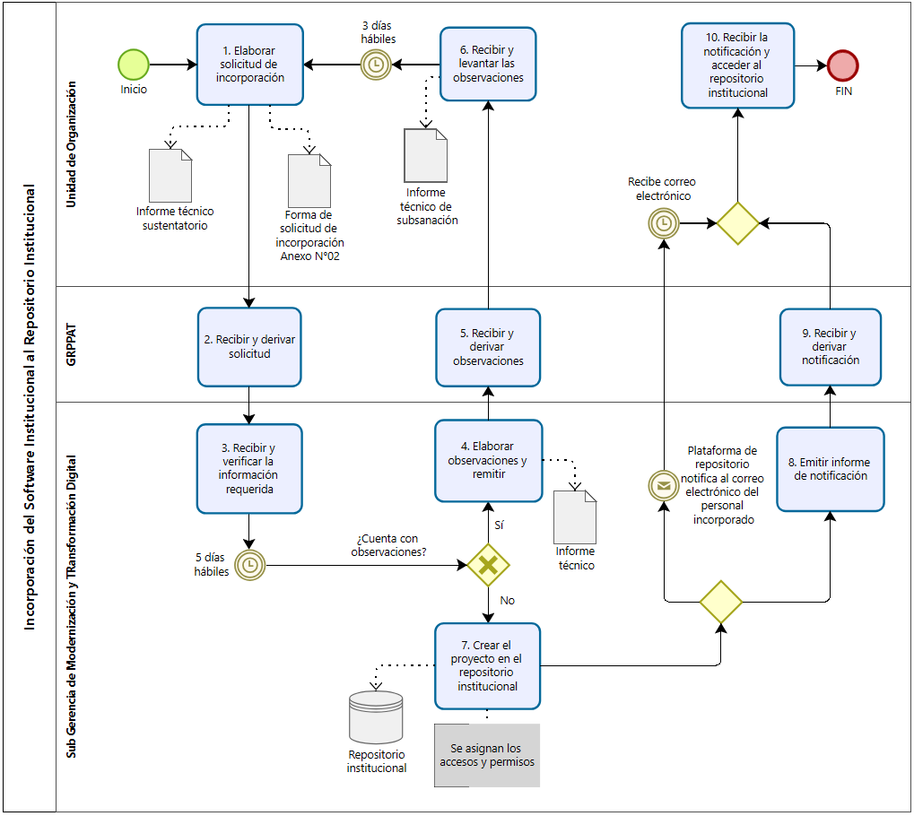
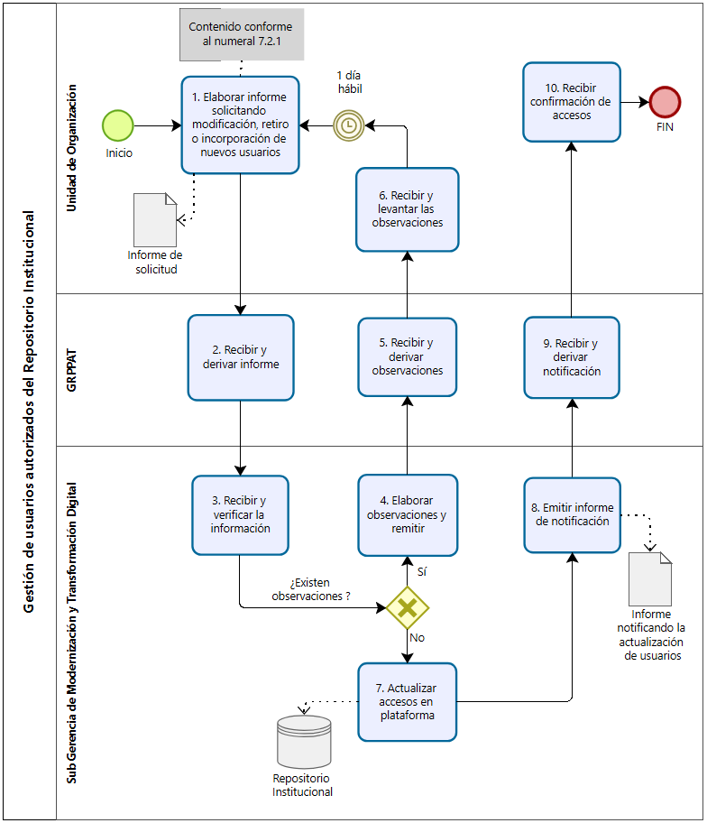
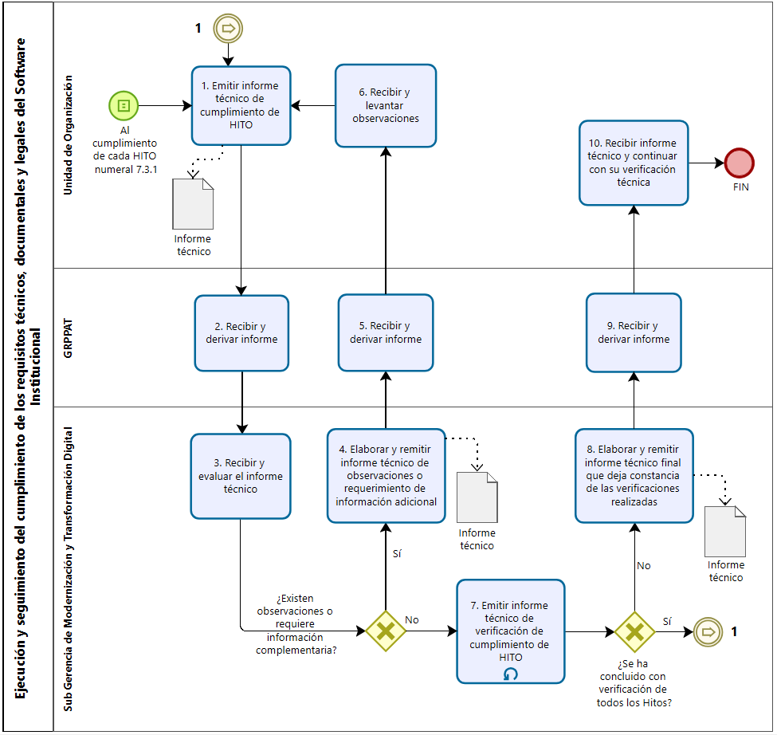
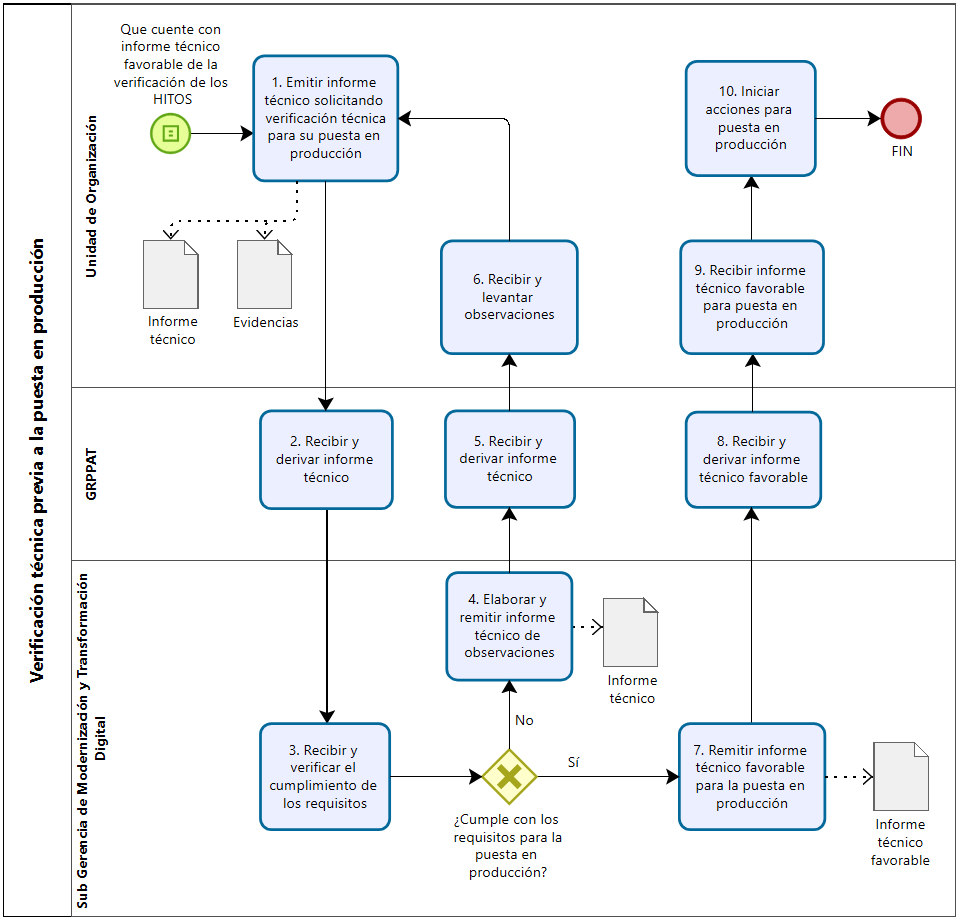
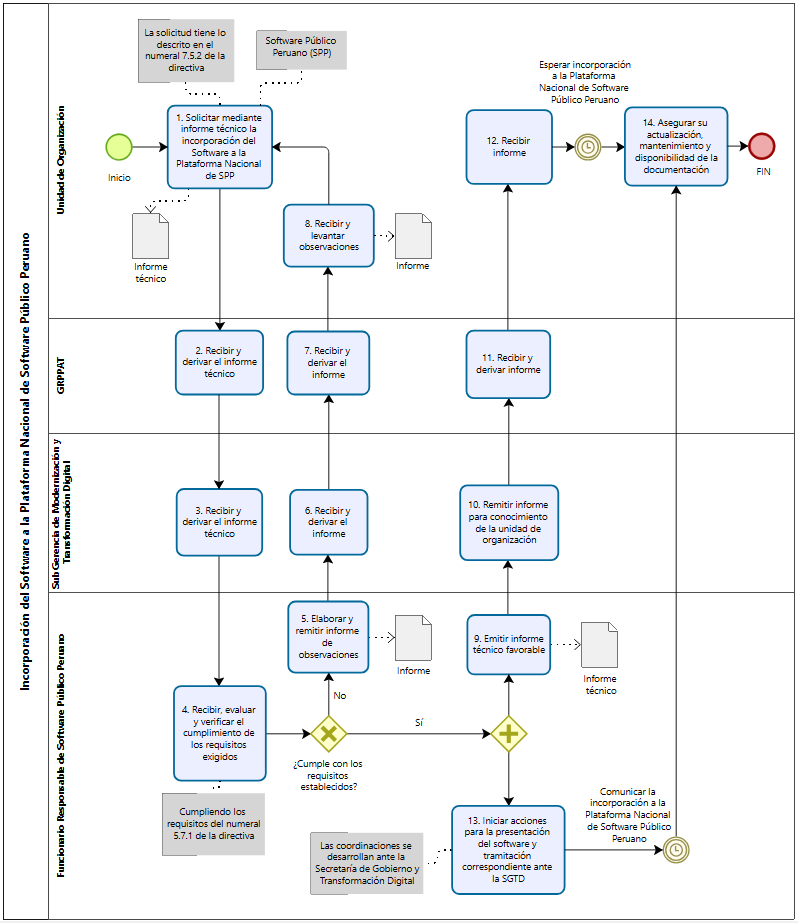

# Directiva N°02.S5.DI.SGMTD – V1.0

**"Directiva para el desarrollo, documentación, versionamiento, licenciamiento y gestión de repositorios de software institucional en el Gobierno Regional Huánuco"**

> **RESUMEN DE LECTURA — no es copia literal ni fuente normativa.** Para el texto literal usar `directiva-literal.md`; para citar, el original. Resumen elaborado a partir de `Directiva Software Institucional GOREHCO.docx` (metadatos internos: última modificación 16/09/2026, 116 revisiones). Prevalece siempre el original.
> **Estado de aprobación:** no consta. El PDF `7501018` (versión de julio) solo lleva firma del formulador (22/07/2026) y conformidad del Sub Gerente de la SGMTD (24/07/2026); no hay firma de Asesoría Jurídica ni de la Gerencia General, ni RGG visible. Vigencia: **POR-CONFIRMAR**.
> La numeración se reconstruyó y verificó contra el PDF `7501018`. **Parte del texto está resumido o parafraseado** (numerales 5, 7.1, 7.2, 7.3.5–7.3.9, 7.4, 7.5, 9, 10, 11): para citar, usar el original.
> El Anexo N°05 (matriz de licencias) es un adjunto independiente; se transcribe al final desde `ANEXO N05 Matriz comparativa de licencias libres y abiertas.pdf`.

| Etapa | Responsable |
|---|---|
| Formulado por | Sub Gerencia de Modernización y Transformación Digital (SGMTD) |
| Revisado por | SGMTD · Gerencia Regional de Asesoría Jurídica |
| Aprobado por | Gerencia General Regional |

---

## Resumen operativo (no forma parte de la directiva)

| Concepto | Qué exige | Numeral |
|---|---|---|
| Naturaleza del software | **Solución independiente** (3 hitos) o **componente utilitario** (1 hito + ficha técnica) | 6.1.3, 7.3.1 |
| Repositorio | Todo el código, docs y scripts en el repositorio institucional (SGMTD) | 6.2, 7.1 |
| Formato de la documentación | **Formatos ligeros y versionados dentro del repositorio (p. ej. Markdown)**, incremental y consistente con el estado real | 6.9 |
| Seguridad en repo | Prohibido subir credenciales, tokens, datos personales reales; usar variables de entorno | 6.6 |
| Versionamiento | `X.Y.Z`; primera versión estable para verificación = **1.0.0** | 7.3.2 |
| Licencia | Informe técnico con base en el **Anexo N°05**; si ninguna libre es compatible → privativo institucional sustentado | 6.7, 7.3.3 |
| Si es licencia libre | Glosa (Anexo 06) en la documentación + `LICENCIA.txt` (Anexo 07) + cabecera `@licencia` en cada archivo fuente | 7.3.4 |
| Producción | Nadie pasa a producción sin informe técnico favorable de la SGMTD (salvo parche de seguridad urgente, 24 h) | 7.4 |
| Software ya en producción | **Regularización**: inventario + documentación completa del Anexo 04 en 60 días hábiles | 11.1 |
| SPP | Requiere ≥ 1 año en producción estable + licencia libre/abierta | 7.5 |

---

## I. OBJETIVO

Establecer disposiciones para el desarrollo, documentación, versionamiento, licenciamiento y gestión de repositorios de software institucional, con el fin de asegurar la titularidad, trazabilidad, seguridad de la información y gobernanza técnica del software desarrollado en el Gobierno Regional Huánuco.

## II. FINALIDAD

Estandarizar la gestión del software desarrollado en el Gobierno Regional Huánuco, asegurando documentación mínima, control de versiones, uso del repositorio institucional, seguridad de la información, protección de datos personales y criterios técnicos para su licenciamiento, puesta en producción, permanencia como software privado institucional o, de corresponder, liberación como software libre, abierto o Software Público Peruano.

## III. BASE LEGAL

1. Ley N°27867, Ley Orgánica de Gobiernos Regionales, y modificatorias.
2. Ley N°27444, Ley del Procedimiento Administrativo General, cuyo TUO fue aprobado mediante D.S. N°006-2026-JUS, y modificatorias.
3. Ley N°27658, Ley Marco de Modernización de la Gestión del Estado, y modificatorias.
4. Ley N°27806, Ley de Transparencia y Acceso a la Información Pública (TUO D.S. N°021-2019-JUS; Reglamento D.S. N°007-2024-JUS).
5. Ley N°28612, Ley que norma el uso, adquisición y adecuación del software en la administración pública.
6. Ley N°32069, Ley General de Contrataciones Públicas, y su Reglamento (D.S. N°009-2025-EF), y modificatorias.
7. Ley N°29733, Ley de Protección de Datos Personales, y modificatorias; Reglamento D.S. N°016-2024-JUS.
8. D. Leg. N°1353, que crea la Autoridad Nacional de Transparencia y Acceso a la Información Pública, fortalece el Régimen de Protección de Datos Personales y regula la gestión de intereses.
9. D. Leg. N°822, Ley sobre el Derecho de Autor, y modificatorias.
10. D. Leg. N°1412, Ley de Gobierno Digital.
11. D.S. N°024-2006-PCM, Reglamento de la Ley N°28612.
12. D.S. N°051-2018-PCM, que crea el Portal de Software Público Peruano.
13. D.S. N°029-2021-PCM, Reglamento del D. Leg. N°1412, y sus modificatorias (D.S. N°075-2023-PCM y D.S. N°098-2026-PCM).
14. D.S. N°085-2023-PCM, Política Nacional de Transformación Digital al 2030.
15. D.U. N°006-2020, que crea el Sistema Nacional de Transformación Digital.
16. D.U. N°007-2020, que aprueba el Marco de Confianza Digital.
17. R.S.G.D. N°001-2019-PCM/SEGDI, que aprueba la Directiva N°001-2019-PCM/SEGDI, "Directiva para compartir y usar Software Público Peruano".
18. R.M. N°004-2016-PCM, uso obligatorio de la NTP ISO/IEC 27001:2014, y modificatorias o normas que la sustituyan.
19. R.S.G.T.D. N°003-2023-PCM/SGTD, implementación y mantenimiento del SGSI en las entidades públicas.
20. R.S.G.D. N°005-2018-PCM/SEGDI, Lineamientos para la formulación del Plan de Gobierno Digital.
21. Ordenanza Regional N°013-2023-GRH-CR, ROF del Gobierno Regional Huánuco.
22. R.G.G. N°0167-2025-GRH/GGR, Mapa de Procesos del GRH, Versión 3.0.
23. R.G.G. N°295-2025-GRH/GGR, Directiva N°01.E2.DI.SGMTD–V2.0, "Directiva General para la formulación, modificación y aprobación de documentos normativos en el GRH".

## IV. ALCANCE

De aplicación obligatoria para todas las Unidades de Organización del Pliego Gobierno Regional Huánuco que desarrollen, contraten, mantengan, modifiquen, documenten, versionen, implementen o administren un software.

## V. RESPONSABILIDADES

- **5.1** Las Unidades de Organización del Pliego son responsables de cumplir las disposiciones de la directiva.
- **5.2** La SGMTD es responsable de conducir, supervisar y efectuar el seguimiento técnico de su aplicación.
- **5.3** El Funcionario Responsable del Software Público Peruano coordina las acciones para solicitar la incorporación de software institucional a la Plataforma Nacional de SPP, conforme a la Directiva N°001-2019-PCM/SEGDI.

## VI. DISPOSICIONES GENERALES

### 6.1 De las definiciones

| N° | Término | Definición |
|---|---|---|
| 6.1.1 | Código fuente | Conjunto de instrucciones, archivos, scripts, configuraciones y componentes escritos en lenguaje de programación, que permiten comprender, modificar, mantener, compilar, ejecutar o desplegar un software. |
| 6.1.2 | Código objeto | Versión compilada, empaquetada o ejecutable de un software, generada a partir del código fuente, destinada a su ejecución en un entorno determinado. |
| 6.1.3 | Componente utilitario | Script, librería, módulo o componente de software que no se despliega como sistema o servicio independiente, sino que apoya, automatiza o complementa procesos, sistemas o tareas técnicas ya existentes. |
| 6.1.4 | Control de versiones | Prácticas y mecanismos que permiten registrar, identificar y administrar los cambios sobre el código fuente y demás componentes durante su ciclo de vida, asegurando su trazabilidad. |
| 6.1.5 | Documentación mínima | Documentos técnicos, funcionales y operativos que sustentan el desarrollo, mantenimiento, uso, instalación, configuración, despliegue, operación, pruebas, dependencias y licenciamiento de un software, conforme al anexo correspondiente. |
| 6.1.6 | Licencia de software | Instrumento jurídico que establece las condiciones bajo las cuales puede usarse, modificarse, reproducirse, distribuirse, publicarse, reutilizarse o explotarse un software. |
| 6.1.7 | Matriz de dependencias y licencias | Documento técnico que identifica librerías, paquetes, frameworks, componentes, herramientas o dependencias, precisando versión, origen, finalidad de uso, tipo de licencia, compatibilidad y posibles restricciones. |
| 6.1.8 | Modalidad de desarrollo externo | Software producido, mantenido, adecuado o documentado total y exclusivamente por locadores, empresas proveedoras, consultores o terceros contratados (TdR, contratos u órdenes de servicio). |
| 6.1.9 | Modalidad de desarrollo interno | Software producido, mantenido, adecuado o documentado de manera exclusiva por servidores civiles, equipos técnicos o personal informático propio de las Unidades de Organización, en el marco de sus funciones. |
| 6.1.10 | Modalidad de desarrollo mixto | Software cuyo ciclo de desarrollo, mantenimiento o adecuación se ejecuta de forma conjunta entre personal propio y proveedores o terceros contratados. |
| 6.1.11 | Puesta en producción | Actividad en la que un software, luego de las verificaciones técnicas, es implementado en un entorno operativo real para su uso por usuarios internos, externos o sistemas institucionales. |
| 6.1.12 | Repositorio institucional | Plataforma administrada por la SGMTD para la gestión, control de versiones y trazabilidad del código fuente, scripts, documentación técnica y demás componentes; acceso restringido a usuarios autorizados. |
| 6.1.13 | Software abierto | Software cuyo código fuente está disponible para acceso, revisión, modificación y distribución bajo una licencia de código abierto. |
| 6.1.14 | Software institucional | Programa, sistema, aplicativo, módulo, componente, servicio digital, script, base de datos, interfaz o elemento relacionado, producido bajo cualquier modalidad (interna, externa o mixta), destinado al uso institucional del GRH. |
| 6.1.15 | Software libre | Software que garantiza la libertad de ejecutar, estudiar, modificar, mejorar, copiar y redistribuir el programa, conforme a una licencia libre. |
| 6.1.16 | Software privado institucional | Software institucional cuyo uso, modificación, distribución o publicación se mantiene restringido al GRH por razones técnicas, legales, contractuales, operativas, de seguridad, protección de datos o conveniencia institucional. |
| 6.1.17 | Software Público Peruano | Software que cumple las condiciones, requisitos técnicos, jurídicos y de licenciamiento de la normativa nacional sobre SPP y que puede ser compartido a través de la Plataforma Nacional de SPP. |
| 6.1.18 | Derechos sobre el software | Condición jurídica que permite a la entidad ejercer derechos patrimoniales, de uso o facultades de explotación sobre el software y elementos vinculados, según el título jurídico que los sustente. Comprende: **Titularidad institucional** (el GRH es titular de los derechos patrimoniales: desarrollos internos o contratos con cesión total) y **Licencia de software** (la entidad es solo licenciataria: software privativo de terceros o librerías externas). |

### 6.2 Del desarrollo e incorporación al repositorio institucional

- **6.2.1** Todo software institucional desarrollado por o para el GRH debe incorporarse al repositorio institucional, cuando corresponda y en la medida en que la entidad cuente con los derechos necesarios, conforme a la normativa y a las condiciones contractuales o de licenciamiento.
- **6.2.2** El repositorio institucional es el medio institucional para almacenar y gestionar código fuente, documentación técnica, scripts, archivos de configuración, registros de versiones y demás componentes.
- **6.2.3** La SGMTD genera copias de respaldo periódicas del repositorio institucional.

### 6.3 De la titularidad institucional y derechos patrimoniales

- **6.3.1** Todo software institucional cuenta con evidencia que permite acreditar la titularidad institucional o los derechos patrimoniales de uso, reproducción, modificación, distribución y demás facultades sobre el software, código fuente, documentación, manuales, bases de datos, scripts y componentes.
- **6.3.2** Cuando el desarrollo, mantenimiento, adecuación, soporte o documentación lo realizan terceros, se incorporan disposiciones que aseguren la cesión o acreditación de derechos patrimoniales a favor del GRH (cláusula del **Anexo N°01**).
- **6.3.3** **Determinación de facultades según el origen del software.** La gestión, modificación y distribución se sujeta al siguiente cuadro:

**Tabla 1. Diferenciación de derechos sobre el software institucional**

| Origen del componente / software | Figura jurídica aplicable | Facultades permitidas al GRH |
|---|---|---|
| Desarrollo interno o externo a medida | **Titularidad institucional** (autoría propia o cesión de derechos patrimoniales) | **Control total.** Permite modificar el código, sublicenciarlo, publicarlo o postularlo como SPP. |
| Software o componente privativo de terceros (ej. APIs comerciales) | **Licencia de uso** | **Uso restringido.** Solo uso según contrato. NO permite modificar el código base, sublicenciar ni publicar libremente. |
| Librería o componente Open Source (ej. frameworks) | **Licencia libre / abierta** (derechos conforme a la licencia de origen) | **Uso condicionado.** Permite uso y modificación sujeto a las reglas de su licencia (MIT, GPL, etc.). |

### 6.4 Del versionamiento

- **6.4.1** Todo software institucional se mantiene bajo control de versiones que conserva la trazabilidad de modificaciones, identifica cambios, funcionalidades incorporadas, mejoras, correcciones y registra el estado de madurez del software durante su ciclo de vida.

### 6.5 De la seguridad de la información y protección de datos personales

- **6.5.1** Todo software institucional incorpora, desde su diseño y desarrollo, medidas y controles que aseguran la protección de datos personales, cuando corresponda, y garantizan la seguridad de la información mediante protocolos seguros de almacenamiento y comunicación, algoritmos estándar de codificación y demás mecanismos pertinentes (Ley N°29733, D.U. N°007-2020, R.M. N°004-2016-PCM, R.S.G.T.D. N°003-2023-PCM/SGTD – NTP ISO/IEC 27001).

### 6.6 De la seguridad en el repositorio institucional

- **6.6.1** Se prohíbe incorporar al repositorio credenciales, contraseñas, tokens, claves privadas, certificados digitales, datos personales reales, información confidencial, configuraciones sensibles o cualquier elemento que comprometa la seguridad de la información.
- **6.6.2** Las configuraciones sensibles se gestionan mediante variables de entorno, archivos de ejemplo, gestores de secretos u otros mecanismos equivalentes.
- **6.6.3** Los datos de prueba son ficticios, anonimizados o seudonimizados.

### 6.7 Del licenciamiento

- **6.7.1** La determinación del licenciamiento se sustenta en una evaluación técnica, funcional, legal y de compatibilidad entre las licencias del software y de sus dependencias.

### 6.8 Del Software Público Peruano

- **6.8.1** El software propuesto para la Plataforma Nacional de SPP cumple el D.S. N°051-2018-PCM y la Directiva N°001-2019-PCM/SEGDI.

### 6.9 De los formatos de la documentación técnica

- **6.9.1** La documentación técnica se elabora y mantiene en **formatos ligeros y versionados dentro del repositorio institucional (por ejemplo, archivos Markdown)**, sin eximir del contenido mínimo exigible de los anexos.
- **6.9.2** La documentación técnica se elabora de manera **incremental**, conforme al avance del software, y se mantiene actualizada y consistente con el estado real del software en cada verificación.

## VII. DISPOSICIONES ESPECÍFICAS

### 7.1 Incorporación del software al repositorio institucional

- **7.1.1** Previo al inicio del desarrollo, la Unidad de Organización solicita a la SGMTD, por intermedio de la GRPPAT, su incorporación al repositorio, mediante **informe técnico sustentatorio + formato del Anexo N°02**, suscrito por el jefe de la Unidad de Organización. *La solicitud no requiere documentación técnica completa, licencia ni documentación de producción; estos se desarrollan progresivamente.*
- **7.1.2** La SGMTD verifica en un máximo de **5 días hábiles** y, de corresponder, observa mediante informe técnico.
- **7.1.3** De haber observaciones, la Unidad de Organización subsana en **3 días hábiles** mediante informe técnico.
- **7.1.4** Conforme, la SGMTD crea el proyecto en la plataforma (notificación automática por correo) y emite informe indicando la creación y la asignación de accesos a los responsables técnicos consignados.

### 7.2 Gestión de usuarios autorizados del repositorio

- **7.2.1** Para incorporar, retirar o modificar usuarios, la Unidad de Organización remite informe a la SGMTD (vía GRPPAT) con: nombre del software/repositorio; tipo de solicitud (incorporación, retiro o modificación de roles); nombres completos; modalidad de contratación; cargo o función; usuario en la plataforma; correo asociado; rol solicitado.
- **7.2.2** Observaciones: subsanación en **1 día hábil**.
- **7.2.3** Conforme: la SGMTD actualiza usuarios y emite informe notificando.
- **7.2.4** Ante riesgos de seguridad o incumplimiento, la SGMTD suspende o retira accesos y notifica.

### 7.3 Ejecución y seguimiento de los requisitos técnicos, documentales y legales

#### 7.3.1 Hitos según la naturaleza del software

**a) Software institucional — solución independiente y completa** (hitos progresivos):

| Hito | Contenido mínimo |
|---|---|
| **i. Análisis y diseño** | Requerimientos (preliminar) · Análisis (preliminar) · Diseño (preliminar) · Arquitectura y componentes (preliminar) · Verificación preliminar de titularidad / condiciones contractuales · Control de versiones · Medidas previstas de seguridad y protección de datos · Matriz inicial de dependencias (**Anexo N°03**) |
| **ii. Desarrollo y pruebas** | Avance y actualización de la documentación técnica de desarrollo · Plan de pruebas funcionales y no funcionales · Manual de operaciones · Control de versiones y trazabilidad · Actualización de la matriz de dependencias (Anexo N°03) · Implementación de medidas de seguridad y protección de datos |
| **iii. Previo a la puesta en producción** | Manual de usuario · Manual de instalación y configuración · Diccionario de datos · Determinación del licenciamiento · Glosas de licencia (cuando corresponda) · Archivo **"LICENCIA.txt"** (cuando corresponda) · Referencias de licencia en el código fuente (cuando corresponda) · Verificación de la versión candidata y su registro de cambios · Verificación definitiva de titularidad · Verificación integral conforme al **Anexo N°04** |

**b) Componente utilitario** (numeral 6.1.3) — **hito único**: Ficha técnica del componente (**Anexo N°04-A**) · Control de versiones y trazabilidad · Matriz de dependencias (Anexo N°03) · Determinación del licenciamiento · Verificación de titularidad · Medidas de seguridad y protección de datos (cuando corresponda).

#### 7.3.2 Control de versiones: `Mayor.Menor.Corrección (X.Y.Z)`

- **X (mayor):** cambios significativos, nuevas funcionalidades o liberaciones relevantes.
- **Y (menor):** mejoras funcionales, ampliaciones o modificaciones compatibles.
- **Z (corrección):** ajustes, corrección de errores o cambios menores que no modifican la funcionalidad principal.

a) Es **versión mayor (X)** todo cambio que: (i) afecta la compatibilidad de funcionalidades, integraciones o procesos existentes; (ii) modifica la arquitectura, el motor de base de datos o las medidas estructurales de seguridad o protección de datos; o (iii) incorpora un módulo, flujo o funcionalidad fuera del alcance previamente aprobado, independientemente de su extensión. Es **versión menor (Y)** toda extensión o mejora de una funcionalidad existente sin esos efectos.

b) La primera versión estable, destinada a solicitar la verificación técnica previa a producción, es la **"1.0.0"**.

#### 7.3.3 Determinación de la licencia

a) Se sustenta mediante **informe técnico** que considera la **matriz comparativa del Anexo N°05** (adjunto independiente). La SGMTD puede actualizar dicha matriz mediante documento técnico complementario.
b) Si ninguna licencia libre o abierta resulta compatible con las características técnicas, funcionales o legales, se adopta un **esquema de software privativo institucional**, debidamente sustentado.
c) El informe técnico de determinación de licencia forma parte del **expediente técnico** del software.

#### 7.3.4 Si se determina licencia libre o abierta

a) La documentación incorpora las **glosas del Anexo N°06**.
b) El repositorio incorpora el archivo **"LICENCIA.txt"** conforme al **Anexo N°07**.
c) **Todos los archivos fuente** incorporan comentarios/encabezados que identifican la licencia o remiten a "LICENCIA.txt".

**Tabla 2. Ejemplos de nota o comentario de licencia**

```text
/* (…)
@licencia [nombre de la licencia libre o abierta] ver LICENCIA.txt
(…) */

/* (…)
@licencia ver LICENCIA.txt
(…) */

''' (…)
@licencia ver LICENCIA.txt
(…) '''
```

#### 7.3.5 – 7.3.9 Trámite de cada hito

- **7.3.5** Al cumplir cada hito, la Unidad de Organización remite **informe técnico** a la SGMTD (vía GRPPAT).
- **7.3.6** La SGMTD verifica y, de corresponder, observa; la Unidad de Organización subsana mediante informe técnico.
- **7.3.7** Conforme el hito, la SGMTD emite informe técnico que deja constancia de verificaciones, observaciones y subsanaciones.
- **7.3.8** Verificados todos los hitos, la SGMTD emite **informe técnico final**. *El informe técnico favorable es requisito obligatorio y previo para solicitar la verificación técnica de puesta en producción.*
- **7.3.9** La SGMTD efectúa el seguimiento de cada hito y puede solicitar información complementaria, observar y requerir subsanaciones.

### 7.4 Verificación técnica previa a la puesta en producción

- **7.4.1** El software independiente con informe técnico favorable puede solicitar la verificación técnica, mediante informe técnico a la SGMTD (vía GRPPAT).
- **7.4.2** Adjunta como mínimo: informe técnico favorable del seguimiento · evidencias de funcionamiento (capturas, videos, registros de pruebas, accesos de demostración) · informe técnico de determinación de licencia · evidencias de titularidad · evidencias de medidas de seguridad y protección de datos (cuando corresponda) · demás documentación de sustento.
- **7.4.3** Observaciones: la SGMTD emite informe técnico; la Unidad de Organización subsana mediante informe técnico.
- **7.4.4** Conforme: la SGMTD emite **informe técnico favorable para la puesta en producción**.
- **7.4.5** **Software ya en producción:** toda nueva versión **mayor (X)**, cambio de arquitectura o modificación que afecte la seguridad o protección de datos se somete nuevamente a verificación técnica. Las versiones **Y o Z** no requieren nueva verificación completa, pero si se actualiza la documentación técnica se informa a la SGMTD **para conocimiento**.
  *Excepción por seguridad:* ante una vulnerabilidad que amerite corrección inmediata, puede aplicarse sin conformidad previa, debiendo: (1) comunicar a la SGMTD dentro de **24 horas** del despliegue (riesgo y solución); (2) registrarla en el control de versiones (7.3.2); (3) actualizar y remitir la documentación en **5 días hábiles** para regularizar la conformidad.
- **7.4.6** Ningún software institucional es puesto en producción sin informe técnico favorable de la SGMTD, salvo el supuesto excepcional del 7.4.5.

### 7.5 Incorporación a la Plataforma Nacional de Software Público Peruano

- **7.5.1** Puede solicitarse (informe técnico a la SGMTD vía GRPPAT, para el Funcionario Responsable de SPP) si el software: (1) cuenta con informe favorable de puesta en producción; (2) está en producción con versión estable; (3) lleva en producción comprobada **mínimo 1 año**; (4) cuenta con licencia libre o abierta compatible con SPP; (5) cumple el D.S. N°051-2018-PCM y la Directiva N°001-2019-PCM/SEGDI.
- **7.5.2** El informe contiene: sustento de la propuesta · formato de especificación general (**Anexo N°08**) · "LICENCIA.txt" para SPP (**Anexo N°09**) · evidencia de ≥ 1 año en producción estable · documentación adicional exigida por la normativa SPP.
- **7.5.3 – 7.5.5** El Funcionario Responsable de SPP evalúa; de haber observaciones (en coordinación con Asesoría Jurídica) se devuelven para subsanación; conforme, emite informe favorable y tramita ante la SGTD.
- **7.5.6** Las actuaciones posteriores ante la Plataforma se sujetan a las disposiciones de la SGTD.
- **7.5.7** La Unidad de Organización mantiene la responsabilidad de actualización, mantenimiento, disponibilidad de la documentación y atención de observaciones.

## VIII. PROCESO RELACIONADO

Proceso de apoyo de nivel 1 **S5.2 Desarrollo e Implementación de Servicios Digitales**, del proceso **S5. Gestión de Transformación Digital** (Mapa de Procesos v3.0, R.G.G. N°0167-2025-GRH/GGR).

| Proceso Nivel 0 | | Proceso Nivel 1 | |
|---|---|---|---|
| S5 | Gestión de Transformación Digital | S5.2 | Desarrollo e Implementación de Servicios Digitales |

## IX. DISPOSICIONES COMPLEMENTARIAS

- **9.1** La SGMTD puede actualizar la plataforma de alojamiento, estructura de repositorios, nomenclatura, reglas de acceso, políticas de ramas, plantillas, formatos o mecanismos técnicos de control de versiones. Si ello cambia obligaciones, requisitos, procedimientos, derechos o plazos de la directiva, debe tramitarse como modificación del documento normativo.
- **9.2** **Unidades Ejecutoras:** la dependencia equivalente a la SGMTD hace la evaluación preliminar (verifica, observa, solicita información, emite informe técnico); luego la Unidad Ejecutora remite el expediente completo a la SGMTD (vía GRPPAT) para pronunciamiento final. Pueden solicitar asistencia técnica a la SGMTD.
- **9.3** La incorporación al repositorio no exime de las obligaciones de documentación mínima, versionamiento, titularidad, licenciamiento, seguridad y protección de datos.
- **9.4** Los aspectos técnicos no previstos son atendidos por la SGMTD, sin crear nuevas obligaciones ni modificar procedimientos.

## X. DISPOSICIONES FINALES

- **10.1** Vigencia: a partir del día siguiente de su aprobación por acto resolutivo.
- **10.2** Las Unidades de Organización adoptan obligatoriamente las acciones necesarias para su cumplimiento.
- **10.3** La SGMTD brinda orientación técnica para su implementación.
- **10.4** Toda disposición interna o práctica incompatible se adecúa a esta directiva.
- **10.5** No exime del cumplimiento de normas sobre derecho de autor, contratación pública, seguridad de la información, protección de datos, transparencia y gobierno digital.

## XI. DISPOSICIONES TRANSITORIAS

- **11.1** Las Unidades de Organización con software desarrollado internamente **en producción o con desarrollo concluido** regularizan su adecuación (repositorio, documentación, versionamiento, titularidad, licenciamiento y demás requisitos). Para ello remiten a la SGMTD (vía GRPPAT), en un **plazo máximo de 60 días hábiles** desde la vigencia, el **inventario** del software acompañado de:

  **a) Software institucional que constituye una solución independiente y completa:**
  - Documentación mínima del **Anexo N°04**, en su integridad.
  - Control de versiones y trazabilidad de cambios.
  - Matriz de dependencias (Anexo N°03).
  - Determinación del licenciamiento, mediante informe técnico.
  - Glosas de licencia, cuando corresponda.
  - Archivo "LICENCIA.txt", cuando corresponda.
  - Referencias de licencia en el código fuente, cuando corresponda.
  - Verificación definitiva de titularidad o acreditación de derechos patrimoniales.
  - Implementación de medidas de seguridad y protección de datos personales.
  - Incorporación al repositorio institucional (numeral 7.1).

  **b) Componentes utilitarios:** Ficha técnica (Anexo N°04-A) íntegra · control de versiones · matriz de dependencias · determinación de licencia · verificación de titularidad · medidas de seguridad (cuando corresponda) · incorporación al repositorio (7.1).

  *Unidades Ejecutoras:* evaluación preliminar por su dependencia equivalente antes de remitir a la SGMTD.

- **11.2** El software **en desarrollo no concluido** no entra a regularización: se incorpora al repositorio (7.1) y sigue el seguimiento por hitos (7.3).
- **11.3** A solicitud expresa, se puede regularizar software retirado o fuera de servicio para preservar documentación, código, titularidad o antecedentes.
- **11.4** La SGMTD evalúa el inventario y puede requerir información, observar, solicitar subsanaciones y disponer acciones de regularización.
- **11.5** La regularización **no suspende la operación** del software en producción; pero todo mantenimiento, evolución, nueva funcionalidad o nueva versión posterior se sujeta íntegramente a la directiva.

## XII. ANEXOS

| Anexo | Contenido |
|---|---|
| N°01 | Cláusula modelo sobre cesión de derechos patrimoniales y entrega de código fuente |
| N°02 | Formato de solicitud de incorporación al repositorio institucional |
| N°03 | Formato de matriz de dependencias y licencias |
| N°04 | Cuadro de documentación mínima exigible para software institucional |
| N°04-A | Ficha técnica del componente utilitario |
| N°05 | Matriz comparativa de licencias libres y abiertas (adjunto independiente) |
| N°06 | Glosa de licencia para documentación de software libre, abierto o SPP |
| N°07 | Modelo de LICENCIA.txt para software libre o abierto |
| N°08 | Formato de especificación general del SPP |
| N°09 | Modelo de LICENCIA.txt para SPP |
| N°10 | Procedimiento de incorporación al repositorio institucional |
| N°11 | Procedimiento de gestión de usuarios autorizados del repositorio |
| N°12 | Procedimiento de ejecución y seguimiento de requisitos técnicos, documentales y legales |
| N°13 | Procedimiento de verificación técnica previa a la puesta en producción |
| N°14 | Procedimiento de incorporación a la Plataforma Nacional de SPP |

---

### ANEXO N°01 — Cláusula modelo sobre cesión de derechos patrimoniales y entrega de código fuente

Debe adecuarse a la naturaleza, alcance y condiciones de cada contratación. No aplica cuando la entidad actúa únicamente como licenciataria de software de terceros.

> Por medio de la presente cláusula, el/la **[locador/prestador de servicios/proveedor]** cede a favor de **[la entidad contratante]** los derechos patrimoniales de los cuales sea titular sobre el programa de ordenador, software, módulo, componente, script, documentación técnica o entregable desarrollado en ejecución del presente contrato, orden de servicio, convenio o instrumento aplicable.
>
> La cesión comprende únicamente los derechos patrimoniales de titularidad del cedente respecto de los desarrollos específicamente realizados en ejecución de la contratación, quedando excluidos los componentes preexistentes o de terceros, cuyo régimen jurídico y licencia deben encontrarse expresamente identificados en la matriz de dependencias y licencias.
>
> La cesión se otorga para su explotación no exclusiva, ilimitada, por todo el plazo de protección legal de los derechos patrimoniales que resulte aplicable, y con alcance mundial, comprendiendo cualquier uso institucional actual o futuro que [la entidad contratante] estime pertinente.
>
> La cesión comprende, sin limitarse a ello, los derechos de reproducción, comunicación al público, distribución, traducción, adaptación, modificación u otra transformación, importación al territorio nacional de copias por cualquier medio, incluida la transmisión, así como cualquier otra forma de utilización o explotación que no se encuentre contemplada como excepción al derecho patrimonial en la normativa sobre derecho de autor.
>
> Asimismo, **[la entidad contratante]** podrá poner el software, código fuente, documentación técnica o entregables a disposición de terceros, de otras entidades públicas o del público en general, mediante autorizaciones, licencias libres, licencias abiertas o mecanismos de reutilización, cuando corresponda y conforme a la normativa aplicable.
>
> Sin perjuicio de otras obligaciones a su cargo, el/la **[locador/prestador de servicios/proveedor]** deberá entregar la versión final del software, incluyendo código fuente, código objeto, scripts, base de datos, documentación técnica, manuales, matriz de dependencias y licencias, instrucciones de instalación, configuración y despliegue, sin medidas tecnológicas efectivas, mecanismos de autotutela, contraseñas, restricciones de acceso o cualquier limitación técnica que impida su uso, revisión, mantenimiento, modificación, compilación, despliegue o reutilización por parte de **[la entidad contratante]**.

### ANEXO N°02 — Formato de solicitud de incorporación al repositorio institucional

**I. Datos generales del proyecto**

| Información requerida | Instrucciones de llenado |
|---|---|
| Nombre tentativo del software | Nombre propuesto con el que se identificará el proyecto o sistema. |
| Unidad de Organización responsable | Nombre de la UO, según el ROF, dueña del proyecto. |
| Finalidad del desarrollo | Objetivo del software, problema que resuelve y beneficio institucional. |
| Naturaleza del desarrollo | "Software institucional independiente" (sistema completo) o "Componente utilitario" (script, librería, módulo de apoyo). |
| Modalidad de desarrollo | Interna, Externa o Mixta. |
| Responsable técnico | Nombres, apellidos y cargo de quien lidera técnicamente el proyecto. |
| Alcance preliminar | Funcionalidades principales o módulos básicos. |
| Tecnologías previstas | Lenguajes, frameworks, bases de datos y herramientas. |
| Denominación sugerida para el repositorio | Minúsculas, sin espacios ni caracteres especiales, separado por guiones (ej. `sistema-tramite-grh`). |

**II. Relación de usuarios autorizados al repositorio**

| Nombres y apellidos | Cargo o función | Usuario en la plataforma | Correo asociado | Rol solicitado* |
|---|---|---|---|---|
| [Ej: Juan Pérez] | [Ej: Desarrollador Backend] | [Ej: jperez-dev] | [Ej: jperez@regionhuanuco.gob.pe] | [Ej: Escritura] |

**(\*) Roles de acceso**

| Rol | Alcance |
|---|---|
| Lectura (Read) | Ver y clonar; crear issues y pull requests; comentar. **No** modifica código. |
| Triaje (Triage) | Lo anterior + gestionar issues y PRs (clasificación, organización). **No** modifica código. |
| Escritura (Write) | Ver, clonar y **registrar cambios** (commits/push); gestionar issues y PRs. |
| Mantenimiento (Maintain) | Escritura + administrar configuraciones operativas (ej. ramas protegidas). |
| Administración (Admin) | Administración integral: usuarios, permisos, seguridad, flujos de trabajo. |

*Firma del Jefe de la Unidad de Organización.*

### ANEXO N°03 — Formato de matriz de dependencias y licencias

**1. Datos generales:** Nombre del software/componente · Licencia elegida para el software.

**2. Matriz de dependencias**

| Capa / Componente (librería, framework, paquete, etc.) | Versión | Licencia de origen | ¿Compatible con la licencia elegida? (Sí/No) |
|---|---|---|---|
| **BACKEND** | | | |
| 1. | | | |
| **FRONTEND** | | | |
| 1. | | | |
| **BASE DE DATOS Y OTROS** | | | |
| 1. | | | |

*Agregar las filas necesarias según la cantidad de dependencias.*

### ANEXO N°04 — Cuadro de documentación mínima exigible para software institucional

Se elabora progresivamente y debe estar completa antes de la puesta en producción, implementación o uso institucional.

| N° | Documento | Contenido mínimo exigible |
|---|---|---|
| 1 | **Manual de instalación y configuración** (Obligatorio) | Datos generales (nombre, versión, descripción) · Requisitos de hardware · Requisitos de software (SO, BD, servidor de aplicaciones, navegador, librerías) · Proceso de instalación tarea por tarea **con capturas de pantalla** · Proceso de configuración, buenas prácticas y recomendaciones · Contacto institucional · **Tipo de licencia aplicable** |
| 2 | **Manual de usuario** (Obligatorio) | Datos generales (nombre, versión, funcionalidad principal) · Funcionalidad del software (actividades, tareas, módulos, reportes, gestión de tablas) · **Tipo de licencia aplicable** |
| 3 | **Diccionario de datos** (Obligatorio) | **Modelo de datos: diagrama Entidad-Relación o modelo relacional** · Diccionario: tablas, atributos, tipo de dato, **PK, FK y restricciones** · **Tipo de licencia aplicable** |
| 4 | **Documentación técnica de desarrollo** (Obligatorio) | Requerimientos (RF, RNF y reglas de negocio) · Análisis (casos de uso, historias de usuario o flujos) · Diseño (**prototipos de interfaz y diagramas de secuencia**) · Arquitectura y componentes (arquitectura general, **diagrama de componentes y de despliegue**) · Plan de pruebas funcionales y no funcionales (**matriz de casos de prueba, criterios de aceptación y reporte de resultados**) · Manual de operaciones (despliegue, monitoreo de errores, **backup y restauración**) · **Tipo de licencia aplicable** |

### ANEXO N°04-A — Ficha técnica del componente utilitario

| N° | Contenido | Condición |
|---|---|---|
| 1 | Datos generales: nombre, versión, descripción y finalidad | Obligatorio |
| 2 | Requisitos técnicos mínimos: lenguaje, versión, entorno de ejecución y dependencias | Obligatorio |
| 3 | Instrucciones de uso, ejecución o integración | Obligatorio |
| 4 | Responsable técnico o mantenedor: nombre y contacto | Obligatorio |
| 5 | Diccionario de datos | Condicional — solo si administra su propio modelo de datos |

### ANEXO N°05 — Matriz comparativa de licencias libres y abiertas

> Transcrita visualmente del PDF adjunto (que es una imagen sin texto; su cabecera indica "Página: 30 de 40"). **Extracción SIN-REVISAR:** antes de citar una celda, contrastarla con el PDF original. Las celdas resaltadas en amarillo en el original son: EUPL v1.2, CeCILL v2.1, AGPL v3, GPL v3 y GPL v2.

| Tipo | Licencia | Modificar | Redistribuir | Mantener copyright/licencia | Restricción nombre/aval | Patentes explícitas | Garantía | Redistribución de binarios/ejecutables | Copyleft | Alcance del copyleft | Anti-tivoización/DRM | Uso en red/SaaS | Uso propietario sin liberar todo | Licencia en derivados | Traducción oficial al español | Uso principal | Nota clave |
|---|---|---|---|---|---|---|---|---|---|---|---|---|---|---|---|---|---|
| Especializada | **EUPL v1.2** | Sí | Sí | Sí | No | Sí | Sin garantía | Acceso al código fuente cuando se distribuye o comunica | Fuerte | Obra derivada / programa distribuido o comunicado | Sí | Sí / Parcial fuerte | No | EUPL o licencias compatibles del apéndice | **Sí, oficial** | Software público / institucional | Recomendable para SGD por copyleft fuerte, compatibilidad y traducción oficial |
| Especializada | **CeCILL v2.1** | Sí | Sí | Sí | No | Sí | Sin garantía | Entregar o poner disponible código fuente completo | Fuerte | Programa derivado completo | No | No | No | CeCILL o GPL compatible | Sí, oficial francés; español no central | Software público / europeo | Similar a GPL, pensada para entorno francés/europeo |
| Especializada | CeCILL-C | Sí | Sí | Sí | No | Sí | Sin garantía | Liberar modificaciones de la librería | Débil | Librería / componente | No | No | Sí | Librería modificada bajo CeCILL-C | Sí, oficial francés; español no central | Librerías | Similar a LGPL |
| Especializada | CeCILL-B | Sí | Sí | Sí | No | No | Sin garantía | Incluir licencia | No | — | No | No | Sí | Cualquiera | Sí, oficial francés; español no central | Software | Equivalente permisivo tipo BSD/MIT |
| Copyleft fuerte | **AGPL v3** | Sí | Sí | Sí | No | Sí | Sin garantía | Entregar o poner disponible código fuente completo | Fuerte | Programa derivado completo | Sí | **Sí** | No | Debe mantenerse AGPL v3 compatible | Traducción no oficial | Software web / SaaS | Obliga a ofrecer código también cuando se usa por red |
| Copyleft fuerte | **GPL v3** | Sí | Sí | Sí | No | Sí | Sin garantía | Entregar o poner disponible código fuente completo | Fuerte | Programa derivado completo | Sí | **No** | No | Debe mantenerse GPL v3 compatible | Traducción no oficial | Software | Mayor protección frente a patentes, DRM y restricciones técnicas |
| Copyleft fuerte | **GPL v2** | Sí | Sí | Sí | No | Parcial / implícita | Sin garantía | Entregar o poner disponible código fuente completo | Fuerte | Programa derivado completo | No | No | No | Debe mantenerse GPL compatible | Traducción no oficial | Software | Copyleft clásico |
| Copyleft débil | MPL 2.0 | Sí | Sí | Sí | No | Sí | Sin garantía | Liberar archivos modificados bajo MPL | Débil | Archivo | No | No | Sí | Archivos MPL modificados bajo MPL; resto puede tener otra licencia | No oficial única | Software | Protege archivo por archivo |
| Copyleft débil | EPL 2.0 | Sí | Sí | Sí | No | Sí | Sin garantía | Liberar módulos/componentes EPL modificados | Débil | Módulo / componente | No | No | Sí | Módulos EPL modificados bajo EPL | No oficial única | Software | Usada en software modular |
| Copyleft débil | LGPL v3 | Sí | Sí | Sí | No | Sí | Sin garantía | Liberar modificaciones de la librería | Débil | Librería | Sí | No | Sí | Librería modificada bajo LGPL | Traducción no oficial | Librerías | Versión moderna, alineada a GPL v3 |
| Copyleft débil | LGPL v2.1 | Sí | Sí | Sí | No | No | Sin garantía | Liberar modificaciones de la librería | Débil | Librería | No | No | Sí | Librería modificada bajo LGPL | Traducción no oficial | Librerías | Permite enlazar con software propietario |
| Permisiva | Apache 2.0 | Sí | Sí | Sí + NOTICE | Sí | Sí | Sin garantía | Incluir licencia y NOTICE si aplica | No | — | No | No | Sí | Cualquiera | No oficial única | Software | Buena protección de patentes, pero permite cerrar derivados |
| Permisiva | BSD-3 | Sí | Sí | Sí | Sí | No | Sin garantía | Incluir licencia y aviso copyright | No | — | No | No | Sí | Cualquiera | No oficial única | Software | Agrega restricción de uso del nombre para avalar derivados |
| Permisiva | MIT | Sí | Sí | Sí | No | No | Sin garantía | Incluir licencia y aviso copyright | No | — | No | No | Sí | Cualquiera | No oficial única | Software | Muy simple y flexible, pero permite cerrar derivados |
| Permisiva | BSD-2 | Sí | Sí | Sí | No | No | Sin garantía | Incluir licencia y aviso copyright | No | — | No | No | Sí | Cualquiera | No oficial única | Software | Similar a MIT |
| Permisiva | ISC | Sí | Sí | Sí | No | No | Sin garantía | Incluir licencia y aviso copyright | No | — | No | No | Sí | Cualquiera | No oficial única | Software | Equivalente simple a MIT/BSD |
| Permisiva | BSD-0 | Sí | Sí | No | No | No | Sin garantía | No exige aviso/licencia | No | — | No | No | Sí | Cualquiera | No oficial única | Software | Casi dominio público |
| Dominio público | The Unlicense | Sí | Sí | No | No | No | Sin garantía | No requerida | No | — | No | No | Sí | Cualquiera | No oficial única | Software | Renuncia amplia; puede generar dudas jurídicas fuera de EE.UU. |
| Dominio público | CC0 | Sí | Sí | No | No | No | Sin garantía | No requerida | No | — | No | No | Sí | Cualquiera | Traducción oficial de Creative Commons | Contenido / datos / software | Mejor para contenidos o datos; no suele ser ideal para software institucional crítico |

**Leyenda de criterios**

| Criterio | Significado |
|---|---|
| Modificar | Si la licencia permite alterar, adaptar, corregir o mejorar el código fuente. |
| Redistribuir | Si se permite entregar copias del software original o modificado a terceros. |
| Mantener copyright / licencia | Si al redistribuir deben conservarse avisos de autoría, titularidad, texto de licencia o archivo equivalente (LICENSE.txt, LICENCIA.txt o avisos en el código). |
| Restricción nombre / aval | Si impide usar el nombre de la entidad titular o autores para promocionar o avalar derivados sin autorización. En el GRH evita que terceros presenten sus versiones como oficiales o avaladas por la entidad. |
| Patentes explícitas | Si incluye autorización expresa sobre patentes del licenciante; reduce riesgos respecto de patentes de quien libera el software. |
| Garantía | Si ofrece garantía sobre el funcionamiento; en la mayoría el software se entrega "sin garantía". |
| Redistribución de binarios / ejecutables | Qué debe entregarse cuando se distribuye compilado o listo para ejecución. En copyleft fuerte normalmente debe garantizarse el acceso al código fuente. |
| Copyleft | Si obliga a que las versiones modificadas o derivadas mantengan condiciones libres o abiertas. Sin copyleft, un tercero puede tomar el código y convertir su derivado en propietario. |
| Alcance del copyleft | Hasta dónde alcanza la obligación: todo el programa, solo archivos modificados, una librería o un módulo. |
| Anti-tivoización / DRM | Si evita que se entregue software libre bloqueado técnicamente en un dispositivo o entorno cerrado. |
| Uso en red / SaaS | Si regula escenarios donde el software modificado se usa como servicio en línea, sin entregar copia directa. **Relevante para sistemas web o plataformas por internet.** |
| Uso en software propietario sin liberar todo | Si un tercero puede incorporar el código en un producto cerrado sin liberar el sistema completo. Importante para evitar apropiaciones privadas de desarrollos financiados con recursos públicos. |
| Licencia en derivados | Bajo qué licencia puede distribuirse una versión modificada o derivada. |
| Traducción oficial al español | Si existe texto oficial en español; reduce riesgos de interpretación jurídica. |
| Uso principal | Tipo de uso para el cual la licencia suele ser más adecuada. |
| Nota clave | Característica más importante o distintiva de cada licencia. |

### ANEXO N°06 — Glosa de licencia para documentación de software libre, abierto o SPP

> El presente **[Tipo de documento]**, de titularidad del **[Nombre de la entidad]**, es compartido bajo la Licencia Creative Commons Reconocimiento – Compartir Igual 4.0 Internacional (CC BY-SA 4.0), la cual permite copiar y redistribuir el material en cualquier medio o formato, así como adaptarlo, remezclarlo, transformarlo y crear a partir del mismo para cualquier finalidad, incluso comercial, siempre que se cumplan las siguientes condiciones:
>
> a) **Reconocimiento:** deberá reconocerse adecuadamente la autoría, proporcionarse un enlace a la licencia e indicarse si se han realizado cambios. Dicho reconocimiento podrá realizarse de cualquier manera razonable, pero sin sugerir que se cuenta con el apoyo del licenciante.
> b) **Compartir Igual:** si se remezcla, transforma o crea material derivado a partir del presente documento, deberá difundirse la contribución bajo la misma licencia que el original.
> c) **Sin restricciones adicionales:** no podrán aplicarse términos legales, medidas tecnológicas o condiciones adicionales que restrinjan legalmente los usos permitidos por la licencia.
>
> Enlace de la licencia: <https://creativecommons.org/licenses/by-sa/4.0/legalcode.es>
>
> Los permisos que excedan el alcance de la presente licencia podrán solicitarse a la Sub Gerencia de Modernización y Transformación Digital o al Funcionario Responsable del Software Público Peruano, según corresponda.

### ANEXO N°07 — Modelo de LICENCIA.txt para software libre o abierto

Para software liberado como libre o abierto, sin que necesariamente se incorpore a la Plataforma de SPP. Debe adecuarse a la licencia seleccionada y no puede establecer condiciones contrarias a ella.

```text
Nombre del software: [Nombre del software]
Entidad titular: [Nombre de la entidad]
Versión del software: [Versión]
Licencia aplicable: [Nombre completo de la licencia libre o abierta]
Archivo de licencia: LICENCIA.txt

El presente software es de titularidad del [Nombre de la entidad] y se libera bajo los términos
de la licencia [Nombre completo de la licencia], permitiendo su uso, revisión, modificación,
redistribución y reutilización conforme a las condiciones establecidas en dicha licencia.

Las redistribuciones del código fuente deberán conservar la información sobre titularidad,
derechos de autor, licencia aplicable y referencia al presente archivo LICENCIA.txt.

Cualquier modificación, derivación o bifurcación del software deberá respetar los términos de la
licencia libre o abierta bajo la cual se libera el código fuente.

El presente software se entrega sin garantía de ningún tipo. En ningún caso el [Nombre de la
entidad] será responsable por daños, riesgos, perjuicios, pérdida de información, afectación de
datos, aplicaciones, infraestructura tecnológica o cualquier consecuencia directa o indirecta
derivada del uso, modificación, implementación o redistribución del software.

Se entienden incorporados al presente archivo los términos completos de la licencia [Nombre
completo de la licencia], cuyo texto deberá ser incluido a continuación o adjuntado en el mismo
repositorio.

[Insertar aquí el texto completo de la licencia libre o abierta aplicable, o la referencia oficial.]
```

### ANEXO N°08 — Formato de especificación general del Software Público Peruano

**Información general**

| Ítem | Campo | Condición |
|---|---|---|
| a) | Logo (.jpg, .png u otro) | Opcional |
| b) | Nombre del software | Obligatorio |
| c) | Entidad titular | Obligatorio |
| d) | Descripción: funcionalidad principal, alcance y finalidad institucional | Obligatorio |
| e) | Palabras clave separadas por comas (ej. Java, .NET, trámite documentario) | Obligatorio |
| f) | Versión (ej. 0.1, 1.0, 1.1) | Obligatorio |
| g) | Procesos soportados: estratégicos, misionales o de apoyo | Opcional |
| h) | Especificación técnica: sistema operativo · base de datos · lenguaje · entorno de desarrollo sugerido · entorno de ejecución · navegadores soportados | Obligatorio (cada uno) |
| i) | Equipo de desarrollo: responsable · correo institucional · teléfono institucional | Obligatorio (cada uno) |
| j) | Tipo de licencia libre o abierta | Obligatorio |
| k) | Costo estimado del software | Obligatorio |
| l) | Tiempo estimado de desarrollo | Opcional |
| m) | Categoría (salud, educación, administración, gestión documental, etc.) | Obligatorio |
| n) | Funcionario Responsable del SPP | Obligatorio |
| o) | Enlace de la plataforma de alojamiento de código | Opcional |

**Documentación del SPP** (todos obligatorios, con *tipo de licencia libre o abierta*): a) Manual de instalación y configuración · b) Manual de usuario · c) Diccionario de datos (modelo + diccionario) · d) Documentación técnica de desarrollo (requerimientos, análisis, diseño, arquitectura y componentes, plan de pruebas, manual de operaciones). Contenido igual al Anexo N°04.

### ANEXO N°09 — Modelo de LICENCIA.txt para Software Público Peruano

*Nota técnica-legal:* reproduce estrictamente el Anexo N°02 ("Glosa para liberar el código del SPP utilizando una licencia libre o abierta") de la Directiva N°001-2019-PCM/SEGDI; no crea un régimen paralelo y debe adecuarse a la licencia seleccionada.

> Este software es puesto a disposición por **[Nombre de la entidad]** con la finalidad de que puedan: i) usarlo o ejecutarlo; ii) copiarlo o reproducirlo; iii) acceder al código fuente, código objeto y documentación técnica; iv) modificarlo o transformarlo en forma colaborativa; y v) distribuirlo a cualquier otra entidad o interesado, siempre que se cumplan las siguientes condiciones:
>
> 1. **Reutilización de software:** Las modificaciones, extensiones o mejoras que utilicen el código fuente de este software deberán ser puestas a disposición de otras entidades o interesados en el sitio web www.softwarepublico.gob.pe.
> 2. **Modificaciones:** Cualquier modificación, derivación o bifurcación que utilice el presente código fuente deberá establecer términos de licenciamiento idénticos a los establecidos en estas condiciones.
> 3. **Compatibilidad:** Se entienden incorporados a la presente licencia los términos establecidos en la **[Nombre de la licencia]**. En consecuencia, dicha licencia es compatible con estas condiciones y ninguna estipulación aquí contemplada podrá ser interpretada en el sentido de contravenir o limitar dicha licencia.
> 4. **Distribución:** Las redistribuciones del código fuente de este software deberán conservar la información sobre los derechos de autor de la entidad que posee la titularidad del software.
> 5. **Permisos adicionales:** Los permisos que vayan más allá de lo cubierto por esta licencia podrán solicitarse al Titular del Software Público.
>
> Este software no otorga NINGUNA GARANTÍA. En ningún caso **[Nombre de la entidad]** será responsable por los daños, riesgos o perjuicios de cualquier índole que, de forma directa o indirecta, produzcan o puedan llegar a producir pérdidas económicas, materiales, o sobre datos y aplicaciones, provocados por el uso de este software, incluso si se ha advertido de la posibilidad de tales daños.

### ANEXOS N°10 a N°14 — Diagramas de procedimiento

| Anexo | Procedimiento | Diagrama |
|---|---|---|
| N°10 | Incorporación del software al repositorio institucional |  |
| N°11 | Gestión de usuarios autorizados del repositorio |  |
| N°12 | Ejecución y seguimiento de requisitos técnicos, documentales y legales |  |
| N°13 | Verificación técnica previa a la puesta en producción |  |
| N°14 | Incorporación a la Plataforma Nacional de SPP |  |
